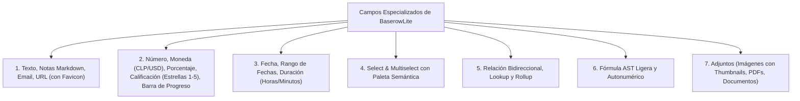

# 💎 Análisis de Ingeniería y Ergonomía: Lo Mejor de Baserow, Airtable y Notion

> **Visión:** Convertir a **BaserowLite** en el motor personal definitivo de bases de datos estructuradas, combinando la solidez relacional y soberanía local de **Baserow**, la sofisticación visual y relacional (Rollups, Lookups, Formatos) de **Airtable**, y la fluidez interactiva y documentación en registro de **Notion**.

---

## 1. Matriz Comparativa: Rescatando lo Mejor de Cada Plataforma

| Capacidad / Dimensión | Airtable (Referente UX) | Baserow (Referente Open Source) | Notion (Referente Contenido) | **BaserowLite (Nuestra Implementación)** |
|---|---|---|---|---|
| **Arquitectura & Huella** | Cloud propietaria cerrada. | Monolito Python/Django + Celery + Nuxt (pesado en RAM). | Cloud propietaria cerrada, sincronización propietaria. | **Next.js 15 + Drizzle + PG16 en Docker (ultra ligero, <300MB RAM, arranque en 1 comando).** |
| **Relaciones entre Tablas** | Bidireccionales fluidas + Rollup + Lookup. | Relaciones básicas M:N (sin Rollups en plan free). | Relaciones bidireccionales + Rollup. | **Relaciones M:N nativas + Rollup (`SUM`, `AVG`, `COUNT`) + Lookup sin duplicación.** |
| **Manejo de Color y Formato** | Paleta pastel semántica, coloreado de fila y celda por reglas. | Paleta básica por opción de select. | Colores de badge y resaltado de texto. | **Paleta de 9 tokens con contraste accesible (claro/oscuro), coloreado condicional de fila/celda y formato CLP (`$ 190.000`).** |
| **Ergonomía de Grid** | Teclado total, freeze columns, agrupación multinivel con agregados. | Virtualizado, pero navegación por teclado más rígida. | Bloques de vista con tabs superiores, ágil. | **Virtualización TanStack (60 FPS), navegación total por teclado (Flechas/Tab/Enter/Esc), freeze columns y tabs superiores tipo Notion.** |
| **Contenido dentro del Registro** | Solo campos en panel lateral. | Modal estándar con campos. | Canvas completo de Markdown dentro de cada fila. | **Drawer lateral con campos estructurados + Editor Markdown enriquecido para notas + Activity Feed de cambios.** |
| **Fórmulas** | Sintaxis rica tipo Excel pero compleja. | Fórmulas limitadas o con sintaxis particular. | Expresiones lógicas simples y formateadas. | **Evaluador AST puro en TypeScript (sin `eval()`), soporte de `IF`, `DATE_ADD`, `CONCAT`, `ROUND` y referencias entre campos.** |
| **Captura y Formularios** | Formularios pulidos con lógica condicional. | Formularios funcionales. | Formularios limitados a páginas públicas. | **Formularios generados desde el schema con Zod, acceso público por token seguro y modo kiosco.** |
| **Privacidad y API** | API con límites de rate estrictos (5 req/s). | API REST buena pero atada a base. | API con bloques JSON engorrosos. | **API REST tokenizada directa sin rate-limits artificiales, exportación CSV inmediata y backups locales SQL.** |

---

## 2. Tipos de Campos Avanzados ("Airtable-Grade")

Para superar a una tabla común y corriente, BaserowLite incorpora tipos especializados:



### Especificación de Campos Clave:
1. **Calificación (`rating`):** Selector visual de 1 a 5 estrellas con clic directo en celda.
2. **Progreso (`progress`):** Barra porcentual visual en la celda (0 a 100%) con color dinámico (verde > 80%, amarillo 40-79%, rojo < 40%).
3. **Moneda Localizada (`currency`):**
   - Configuración por defecto: `CLP` (`$` con separador de miles `.` y sin decimales: `$ 190.000`).
   - Modo divisas: `USD` (`$` con separador de miles `,` y 2 decimales: `$ 1,250.50`).
4. **Relación + Lookup + Rollup:**
   - **Relación:** Vincula filas de la Tabla A con la Tabla B.
   - **Lookup:** Muestra directamente el valor de una columna de la tabla vinculada (ej: al vincular un `Lote` en `Productos`, muestra el `Costo Proveedor` automáticamente).
   - **Rollup:** Ejecuta agregaciones matemáticas sobre los registros vinculados (ej: `SUM(Items.Total)`, `COUNT(Tareas.Pendientes)`, `AVG(Notas)`).

---

## 3. Ergonomía Visual: Notion Tabs + Airtable Grid

### 3.1. Barra de Control Superior Unificada
En lugar de menús ocultos, la cabecera de la tabla ofrece:
```text
[ Tablas: 📦 Productos | 🚢 Importaciones | 🏢 Proveedores ]  [ + Nueva Tabla ]
-----------------------------------------------------------------------------------------
[ Vistas: ▦ Todos los SKUs | 🏷️ Por Canal (Kanban) | 📝 Formulario Captura | ⚠️ Alertas Stock ]
[ 🔍 Buscar... ]  [ ⚡ Filtrar (2) ]  [ ↕️ Ordenar ]  [ 🎨 Color por Estado ]  [ 📥 Exportar CSV ]
```

### 3.2. Agrupación Multinivel y Barras de Agregación
- **Header de Grupo Colapsable:** Agrupa filas por campos tipo `Select` (ej. Agrupado por "Canal de Venta" o "Estado de Embarque").
- **Footer de Totales (Summary Row):** En la parte inferior de cada columna en el Grid:
  - Para campos numéricos/moneda: `Suma`, `Promedio`, `Mínimo`, `Máximo`.
  - Para campos de texto/select: `Recuento de filas`, `Valores únicos`, `Porcentaje rellenas`.

---

## 4. Casos de Uso Reales para el Homelab y Negocio

### Caso de Uso 1: Costeo Vivo de Importaciones y Compras (Navarino / eCommerce)
- **Problema previo:** Las hojas de cálculo son propensas a errores de sobreescritura y Baserow estándar carecía de Rollups fluidos sin licencias complejas.
- **Solución BaserowLite:**
  - **Tabla `Lotes de Compra`:** Código de contenedor, fecha de zarpe, fecha estimada de arribo, naviera, tipo de cambio USD/CLP.
  - **Tabla `Items de Importación`:** SKU, cantidad comprada, costo FOB (USD), aranceles e IVA calculados con campo `formula`, costo unitario final puesto en bodega (CLP `$`).
  - **Rollup:** La tabla `Lotes` suma automáticamente el peso total (kg), volumen ($m^3$) e inversión total en CLP de todos sus items vinculados.
  - **Vista Kanban:** Agrupada por estado del flete (`En Fábrica` ➔ `Zarpado / En Tránsito` ➔ `En Aduana San Antonio` ➔ `Recibido en Bodega`).

### Caso de Uso 2: Sourcing de Empleo y Postulaciones
- **Tabla `Postulaciones`:** Empresa, cargo, enlace de oferta (con favicon), fecha de postulación, salario pretendido (CLP), estado (badge coloreado), CV adjunto, fecha de entrevista.
- **Canvas de Notas (Tipo Notion):** Al abrir la vista Detalle/Drawer, el registro incluye un editor Markdown para tomar notas en vivo de la entrevista, preguntas de la contraparte y feedback.
- **Formateo Condicional:** Si la fecha del último follow-up tiene más de 14 días sin respuesta, la fila se resalta en amarillo suave automáticamente.

### Caso de Uso 3: Catálogo PIM y Enriquecimiento de Fichas
- **Tabla `Catálogo Maestro`:** SKU, nombre, categoría, fotos (con vista previa en miniatura), especificaciones técnicas sagradas.
- **Campos Booleanos / Estado:** `Optimizado SEO`, `Publicado Falabella`, `Publicado ML`, `Publicado Walmart`.
- **Vista Kanban por Canal:** Permite arrastrar un SKU desde "Borrador" hasta "Publicado" actualizando automáticamente el estado vía API hacia Odoo o n8n.

### Caso de Uso 4: Inventario de Servidores y Homelab Yarken
- **Tabla `Nodos & Servidores`:** Hostname (`srv-zbook`, `srv-nuc`, `elitebook`, `nas`), IP LAN (`192.168.60.x`), SO, RAM, rol.
- **Tabla `Servicios Docker`:** Nombre del servicio, contenedor, puerto expuesto, URL pública Cloudflare Zero Trust, estado de monitoreo.
- **Relación:** Cada servicio está vinculado a su nodo anfitrión, permitiendo ver en la ficha de `srv-zbook` la lista completa de servicios que corren en él.

---

## 5. Manual Operativo de Ergonomía para el Usuario

### 5.1. Atajos de Teclado Universales (Productividad Extrema)
| Tecla | Acción en Vista Grid |
|---|---|
| `Flechas (↑, ↓, ←, →)` | Navegar entre celdas activas sin usar el ratón. |
| `Enter` | Entrar en modo edición de la celda. Al confirmar, baja a la fila siguiente. |
| `Tab` / `Shift + Tab` | Confirmar y moverse a la celda de la derecha / izquierda. |
| `Escape` | Salir de la edición descartando cambios no confirmados. |
| `Barra Espaciadora` | Abrir el Drawer de Detalle completo de la fila seleccionada. |
| `Espacio` (en booleano) | Alternar inmediatamente entre activado / desactivado. |
| `Delete` / `Backspace` | Borrar el contenido de la celda seleccionada. |
| `Cmd + K` / `Ctrl + K` | Abrir barra de búsqueda rápida global en la base. |

### 5.2. Reglas de Formato y Presentación
1. **Números Financieros:** Los campos monetarios se formatean siempre de manera limpia. En pesos chilenos nunca llevan decimales (`$ 190.000`), manteniendo alineación a la derecha para facilitar la lectura visual.
2. **Badges de Selects:** Los colores tienen fondo pastel (`bgLight`) y texto oscuro con contraste WCAG AAA para garantizar legibilidad en turnos nocturnos o pantallas de alta resolución.
3. **Exportación sin Fricción:** El botón `Exportar CSV` genera un archivo limpio con codificación UTF-8 con BOM (para compatibilidad nativa con Microsoft Excel en español) y encabezados claros.
