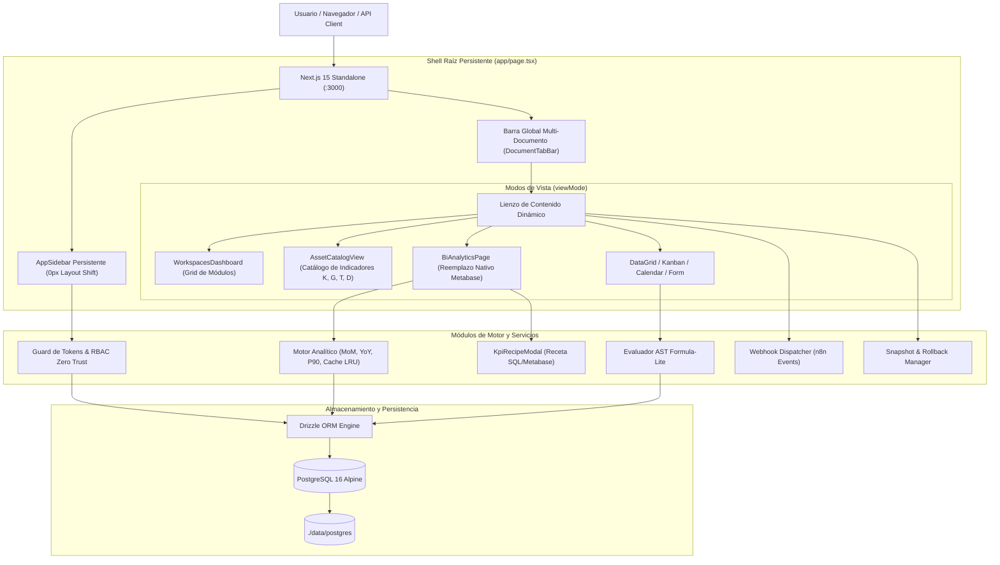

# 🏗️ Arquitectura General del Sistema y Despliegue

Este documento describe la arquitectura global, la infraestructura en contenedores, las políticas de seguridad y la operación local y productiva de **FluxTable** (Sistema Yarken).

---

## 1. Topología del Sistema y Arquitectura Single-Shell



---

## 2. Principios de Diseño y Desacoplamiento de Capas

1. **Arquitectura Single-Shell (Issue #37):**
   - El Sidebar (`AppSidebar`) vive una sola vez a nivel raíz en `app/page.tsx`, envolviendo el lienzo dinámico.
   - Jamás se desmonta ni parpadea al alternar entre pestañas o módulos. El selector de Workspace, el card de usuario y el estado expandido del árbol se mantienen persistentes.
2. **Desacoplamiento entre Capa Visual y Capa Relacional (Issue #36):**
   - **Capa Visual / Organizativa (`bi_folders`):** Soporta infinitos niveles de subcarpetas (`parentId`), códigos de negocio (`01`, `03.2`), emojis nativos y colores de acento.
   - **Capa Física / Invariancia SQL:** Las tablas (`tables`, `records`) y consultas analíticas permanecen atadas a sus IDs inmutables (`t026_flujos_n8n`, `K007`). Mover o crear carpetas jamás rompe endpoints, vistas materializadas ni workflows de n8n.
3. **Reusabilidad Analítica $M:N$ (Issue #36):**
   - Las tarjetas analíticas (`bi_cards`) son entidades autónomas vinculadas a módulos de negocio.
   - La tabla pivote `bi_dashboard_cards` permite que una misma tarjeta ($K007$) se incruste en múltiples tableros ejecutivos ($D001$, $D003$) con posiciones y filtros independientes.

---

## 3. Docker Compose para Ejecución Local y en Bastión ZBook

El proyecto se inicia completamente con:
```bash
docker compose up -d
```

### Definición de `docker-compose.yml`:
```yaml
version: '3.8'

services:
  postgres:
    image: postgres:16-alpine
    container_name: baserow_lite_db
    restart: unless-stopped
    environment:
      POSTGRES_DB: ${POSTGRES_DB:-baserow_lite}
      POSTGRES_USER: ${POSTGRES_USER:-baserow_user}
      POSTGRES_PASSWORD: ${POSTGRES_PASSWORD:-baserow_pass}
    ports:
      - "${POSTGRES_PORT:-5432}:5432"
    volumes:
      - ./data/postgres:/var/lib/postgresql/data
    healthcheck:
      test: ["CMD-SHELL", "pg_isready -U ${POSTGRES_USER:-baserow_user} -d ${POSTGRES_DB:-baserow_lite}"]
      interval: 5s
      timeout: 5s
      retries: 5

  app:
    build:
      context: .
      dockerfile: Dockerfile
    container_name: baserow_lite_app
    restart: unless-stopped
    depends_on:
      postgres:
        condition: service_healthy
    environment:
      NODE_ENV: production
      PORT: 3000
      DATABASE_URL: postgresql://${POSTGRES_USER:-baserow_user}:${POSTGRES_PASSWORD:-baserow_pass}@postgres:5432/${POSTGRES_DB:-baserow_lite}
      APP_SECRET: ${APP_SECRET}
      STORAGE_DRIVER: ${STORAGE_DRIVER:-local}
      LOCAL_STORAGE_PATH: /app/storage/uploads
    ports:
      - "${PORT:-3000}:3000"
    volumes:
      - ./data/uploads:/app/storage/uploads
    healthcheck:
      test: ["CMD", "wget", "--no-verbose", "--tries=1", "--spider", "http://localhost:3000/api/health"]
      interval: 10s
      timeout: 5s
      retries: 3
```

---

## 3. Estrategia de Inicialización y Migraciones Automáticas

Para garantizar que el primer inicio funcione sin intervención manual:
1. El contenedor `app` ejecuta un script de entrada (`entrypoint.sh`):
   ```bash
   #!/bin/sh
   echo "Ejecutando migraciones de base de datos..."
   npx drizzle-kit migrate
   
   echo "Ejecutando seed de bienvenida si la base de datos está vacía..."
   node dist/db/seed.js
   
   echo "Iniciando servidor Next.js..."
   exec node server.js
   ```
2. **Seed de Bienvenida:** Crea automáticamente un Workspace "Principal", una Base "Proyectos y Tareas" con dos tablas vinculadas y registros de demostración con diferentes colores y formatos para probar el sistema de inmediato.

---

## 4. Políticas de Backup y Recuperación de Datos

Todos los datos residen en la carpeta local `./data/`:
- `./data/postgres/`: Datos binarios de PostgreSQL.
- `./data/uploads/`: Archivos adjuntos originales organizados por hash.

### Comando de Respaldo Automatizado (Dump SQL):
```bash
docker exec -t baserow_lite_db pg_dump -U baserow_user -d baserow_lite | gzip > ./backups/backup_$(date +%Y%m%d_%H%M%S).sql.gz
```

### Comando de Restauración:
```bash
gunzip -c ./backups/backup_archivo.sql.gz | docker exec -i baserow_lite_db psql -U baserow_user -d baserow_lite
```
