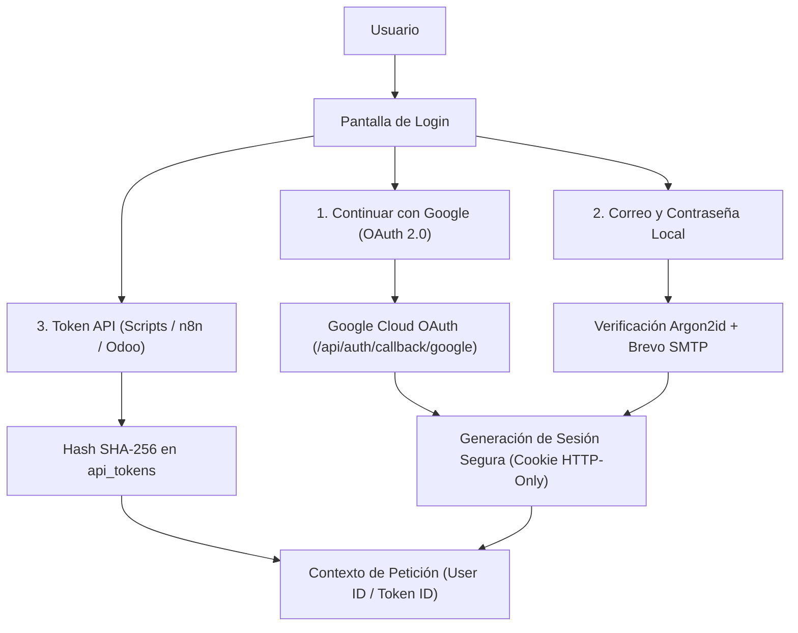

# 🔐 Especificación: Usuarios, Login con Google, Logs y Trazabilidad Forense

> **Contexto:** En Baserow oficial, el **Login con Google (SSO)** está bloqueado tras una licencia Enterprise de pago y la trazabilidad de auditoría está restringida a planes comerciales. En **BaserowLite**, estas capacidades se diseñan como **nativas de primer nivel desde el día 1**, sin restricciones artificiales ni pagos de licencias.

---

## 1. Sistema de Usuarios y Autenticación Dual (Google OAuth + Local)



### 1.1. Login con Google OAuth 2.0 (Nativo)
A diferencia de Baserow oficial (donde en `#839` se documentó que no había botón Google por falta de licencia Enterprise), en BaserowLite se implementa vía `Auth.js` (NextAuth v5) o controlador OAuth nativo con `@auth/core`:
- **Parámetros en `.env`:**
  - `GOOGLE_CLIENT_ID=op://IA/zbook_baserow_google_oauth/client_id`
  - `GOOGLE_CLIENT_SECRET=op://IA/zbook_baserow_google_oauth/client_secret`
- **Flujo:**
  1. Redirección a `accounts.google.com/o/oauth2/v2/auth`.
  2. Callback en `/api/auth/callback/google`.
  3. Si el email ya existe en `users`, vincula la cuenta; si no existe, crea el usuario con `email_verified: true` y avatar de Google.
  4. Restricción de Dominio / Lista Blanca: Variable `ALLOWED_EMAILS=snadales@gmail.com` para evitar que usuarios no autorizados puedan acceder si el servicio se expone públicamente.

### 1.2. Autenticación Local por Correo y Contraseña
- **Seguridad:** Contraseñas hasheadas con **Argon2id** (estándar OWASP superior a bcrypt).
- **Recuperación por Brevo SMTP:** Mismo relay de Brevo que usa el homelab (`EMAIL_SMTP_HOST`, puerto 587 STARTTLS). Generación de tokens de recuperación de 1 hora de validez guardados hasheados.

### 1.3. Esquema Drizzle para Usuarios y Sesiones
```typescript
export const users = pgTable('users', {
  id: uuid('id').defaultRandom().primaryKey(),
  email: text('email').notNull().unique(),
  name: text('name'),
  avatarUrl: text('avatar_url'),
  passwordHash: text('password_hash'), // null si solo usa Google
  googleId: text('google_id').unique(),
  role: text('role', { enum: ['superadmin', 'member'] }).default('member').notNull(),
  isActive: boolean('is_active').default(true).notNull(),
  createdAt: timestamp('created_at', { withTimezone: true }).defaultNow().notNull(),
  updatedAt: timestamp('updated_at', { withTimezone: true }).defaultNow().notNull(),
});

export const sessions = pgTable('sessions', {
  id: uuid('id').defaultRandom().primaryKey(),
  userId: uuid('user_id').references(() => users.id, { onDelete: 'cascade' }).notNull(),
  sessionToken: text('session_token').notNull().unique(),
  ipAddress: text('ip_address'),
  userAgent: text('user_agent'),
  expiresAt: timestamp('expires_at', { withTimezone: true }).notNull(),
  createdAt: timestamp('created_at', { withTimezone: true }).defaultNow().notNull(),
});
```

---

## 2. Logs Estructurados JSON y Debugging en Tiempo Real

Para un monitoreo profesional en ZBook compatible con `docker logs` y herramientas de observabilidad:

### 2.1. Logger Estructurado con `pino`
Cero `console.log` dispersos. Se utiliza `pino` en el servidor:
```typescript
import pino from 'pino';

export const logger = pino({
  level: process.env.LOG_LEVEL || 'info',
  formatters: {
    level: (label) => ({ level: label }),
  },
  timestamp: pino.stdTimeFunctions.isoTime,
});
```

Cada línea emitida tiene formato JSON estructurado:
```json
{
  "level": "info",
  "time": "2026-11-16T22:30:00.123Z",
  "requestId": "req_c7a91b2e",
  "userId": "usr_999",
  "method": "PATCH",
  "path": "/api/database/rows/table/865/4434/",
  "status": 200,
  "durationMs": 8.4,
  "msg": "Registro actualizado exitosamente"
}
```

### 2.2. Middleware de Tracing (`x-request-id`)
En cada petición HTTP (UI o API):
1. El middleware de Next.js verifica si viene la cabecera `x-request-id`; si no, genera un UUIDv4 o nanoid.
2. Inyecta `requestId` en el contexto de ejecución y en la cabecera de respuesta HTTP.
3. Si un script o usuario reporta un error (ej. HTTP 500), el ID `x-request-id` permite correlacionar el log exacto en milisegundos con `docker logs baserow_lite_app | grep req_c7a91b2e`.

### 2.3. Endpoint de Diagnóstico y Salud (`/api/admin/diagnostics`)
Ruta reservada para superadmin o accesos LAN:
- Estado del pool de conexiones PostgreSQL (activas, inactivas, tiempo de espera).
- Memoria RAM consumida por Node.js (`heapUsed`, `rss`).
- Espacio en disco libre en `./data/uploads` y `./data/postgres`.
- Ping de base de datos en milisegundos.

---

## 3. Trazabilidad Forense Completa (`audit_logs`)

En Baserow estándar, el historial de cambios por celda requiere licencia avanzada. En BaserowLite, la trazabilidad es **un pilar central**:

### 3.1. Esquema Forense en Drizzle
```typescript
export const auditLogs = pgTable('audit_logs', {
  id: uuid('id').defaultRandom().primaryKey(),
  workspaceId: uuid('workspace_id').notNull(),
  tableId: uuid('table_id').notNull(),
  recordId: uuid('record_id').notNull(),
  action: text('action', { enum: ['create', 'update', 'delete', 'restore'] }).notNull(),
  
  // Actor responsable
  actorType: text('actor_type', { enum: ['user', 'api_token', 'system'] }).notNull(),
  actorId: text('actor_id').notNull(),       // ID de usuario o nombre de token
  actorEmail: text('actor_email'),          // Email legible (ej. snadales@gmail.com)
  
  // Contexto de red y debug
  ipAddress: text('ip_address'),
  userAgent: text('user_agent'),
  requestId: text('request_id'),
  
  // Datos antes y después (Diff)
  changedFields: jsonb('changed_fields').$type<Record<string, { old: any; new: any }>>(),
  
  createdAt: timestamp('created_at', { withTimezone: true }).defaultNow().notNull(),
}, (t) => [
  index('audit_record_idx').on(t.recordId),
  index('audit_table_date_idx').on(t.tableId, t.createdAt),
]);
```

### 3.2. Experiencia en la Interfaz (Activity Feed en el Drawer)
Al abrir cualquier registro haciendo doble clic o con la `Barra Espaciadora`, la pestaña **Actividad** despliega una línea de tiempo idéntica a GitHub / Notion:
- *"Sebastián Nadales (snadales@gmail.com) cambió **Estado** de `En Tránsito` a `Recibido en Bodega` — Hace 15 minutos"*.
- *"Script `costos/grist_compras.py` (vía Token `navarino-compras-rw`) actualizó **Precio FOB** de `$ 12.50` a `$ 11.80` — Ayer a las 18:30"*.
- **Botón Revertir:** Permite volver a un valor anterior con un solo clic.

---

## 4. Comparativa: Baserow Oficial vs BaserowLite

| Característica | Baserow Oficial en ZBook | BaserowLite (Nuevo) |
|---|---|---|
| **Login con Google (OAuth)** | ❌ Bloqueado (Exige licencia Enterprise de pago). | ✅ **Nativo y gratuito** (usando credenciales propias de Google Cloud). |
| **Lista Blanca de Emails** | ❌ Limitado. | ✅ Variable `ALLOWED_EMAILS` estricta (Zero Trust). |
| **Logs de la Aplicación** | Texto desestructurado de Django/Gunicorn difícil de filtrar. | ✅ **JSON estructurado con Pino** y `requestId` correlacionado. |
| **Historial de Celda (Audit Log)** | ❌ Limitado / Plan Premium. | ✅ **Audit Log forense completo con Diff antes/después** y autor. |
| **Mapeo de Actor en API** | Difícil de asociar token con fila en logs estándar. | ✅ Cada fila auditada indica qué token de 1Password hizo el cambio. |
| **Endpoint de Diagnóstico** | No disponible sin entrar a Django Shell por SSH. | ✅ `/api/admin/diagnostics` accesible vía LAN o admin. |
