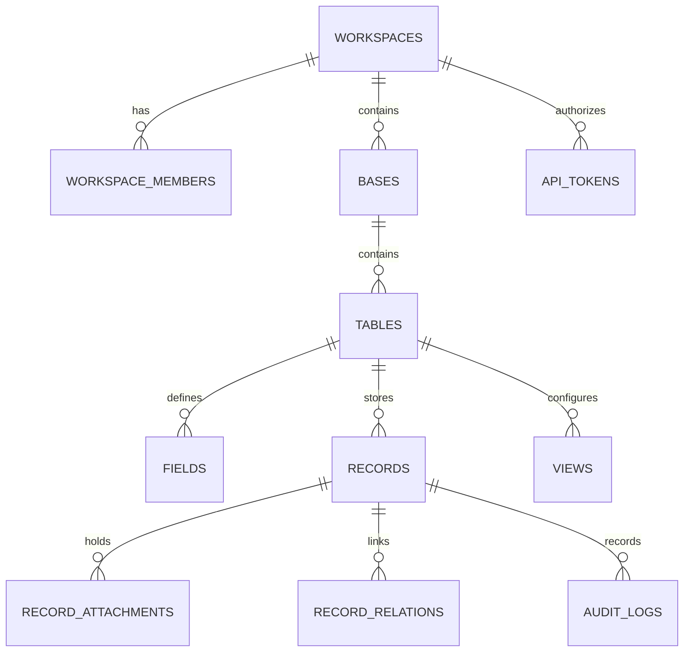

# 🗄️ Modelo de Datos y Esquema Drizzle ORM

Este documento define la arquitectura de almacenamiento de datos para **BaserowLite**, fundamentada en un enfoque **híbrido relacional + JSONB tipado** en PostgreSQL 16 utilizando **Drizzle ORM**.

---

## 1. Justificación del Enfoque Híbrido

Para aplicaciones tipo hoja de cálculo/base de datos no-code:
1. **Esquema Fijo (Relacional):** Estructura organizativa (`workspaces`, `bases`, `tables`, `fields`, `views`, `members`, `api_tokens`). Garantiza integridad referencial, índices eficientes y migraciones estables con Drizzle Kit.
2. **Datos Dinámicos de Filas (`records.data` en JSONB):** Permite añadir, renombrar, reordenar y eliminar campos sin ejecutar costosas operaciones DDL de bloqueo (`ALTER TABLE ... ADD COLUMN`) en PostgreSQL.
3. **Control Atómico y Concurrencia:** La columna `version` (entero) implementa bloqueo optimista. La función `jsonb_set` permite actualizar celdas individuales atómicamente.

---

## 2. Diagrama Entidad-Relación



---

## 3. Definición de Tablas en Drizzle ORM

```typescript
import { 
  pgTable, uuid, text, timestamp, integer, boolean, jsonb, index, uniqueIndex 
} from 'drizzle-orm/pg-core';

// -----------------------------------------------------------------------------
// 1. Usuarios, Sesiones y Espacios de Trabajo
// -----------------------------------------------------------------------------
export const users = pgTable('users', {
  id: uuid('id').defaultRandom().primaryKey(),
  email: text('email').notNull().unique(),
  name: text('name'),
  avatarUrl: text('avatar_url'),
  passwordHash: text('password_hash'), // null si solo usa Google OAuth
  googleId: text('google_id').unique(),
  role: text('role', { enum: ['superadmin', 'member'] }).default('member').notNull(),
  isActive: boolean('is_active').default(true).notNull(),
  createdAt: timestamp('created_at', { withTimezone: true }).defaultNow().notNull(),
  updatedAt: timestamp('updated_at', { withTimezone: true }).defaultNow().notNull(),
});

export const sessions = pgTable('sessions', {
  id: uuid('id').defaultRandom().primaryKey(),
  userId: uuid('user_id').references(() => users.id, { onDelete: 'cascade' }).notNull(),
  sessionToken: text('session_token').notNull().unique(),
  ipAddress: text('ip_address'),
  userAgent: text('user_agent'),
  expiresAt: timestamp('expires_at', { withTimezone: true }).notNull(),
  createdAt: timestamp('created_at', { withTimezone: true }).defaultNow().notNull(),
});

export const workspaces = pgTable('workspaces', {
  id: uuid('id').defaultRandom().primaryKey(),
  name: text('name').notNull(),
  slug: text('slug').notNull().unique(),
  createdAt: timestamp('created_at', { withTimezone: true }).defaultNow().notNull(),
  updatedAt: timestamp('updated_at', { withTimezone: true }).defaultNow().notNull(),
  deletedAt: timestamp('deleted_at', { withTimezone: true }),
});

export const workspaceMembers = pgTable('workspace_members', {
  id: uuid('id').defaultRandom().primaryKey(),
  workspaceId: uuid('workspace_id').references(() => workspaces.id, { onDelete: 'cascade' }).notNull(),
  userId: uuid('user_id').references(() => users.id, { onDelete: 'cascade' }).notNull(),
  role: text('role', { enum: ['owner', 'admin', 'editor', 'viewer'] }).default('editor').notNull(),
  createdAt: timestamp('created_at', { withTimezone: true }).defaultNow().notNull(),
});

// -----------------------------------------------------------------------------
// 2. Bases y Tablas
// -----------------------------------------------------------------------------
export const bases = pgTable('bases', {
  id: uuid('id').defaultRandom().primaryKey(),
  workspaceId: uuid('workspace_id').references(() => workspaces.id, { onDelete: 'cascade' }).notNull(),
  name: text('name').notNull(),
  icon: text('icon').default('table').notNull(),
  color: text('color').default('blue').notNull(),
  order: integer('order').default(0).notNull(),
  createdAt: timestamp('created_at', { withTimezone: true }).defaultNow().notNull(),
  updatedAt: timestamp('updated_at', { withTimezone: true }).defaultNow().notNull(),
  deletedAt: timestamp('deleted_at', { withTimezone: true }),
});

export const tables = pgTable('tables', {
  id: uuid('id').defaultRandom().primaryKey(),
  baseId: uuid('base_id').references(() => bases.id, { onDelete: 'cascade' }).notNull(),
  name: text('name').notNull(),
  primaryFieldId: uuid('primary_field_id'), // Referencia al campo que identifica la fila
  order: integer('order').default(0).notNull(),
  createdAt: timestamp('created_at', { withTimezone: true }).defaultNow().notNull(),
  updatedAt: timestamp('updated_at', { withTimezone: true }).defaultNow().notNull(),
  deletedAt: timestamp('deleted_at', { withTimezone: true }),
});

// -----------------------------------------------------------------------------
// 3. Campos y Metadatos de Formato (Fields)
// -----------------------------------------------------------------------------
export const fields = pgTable('fields', {
  id: uuid('id').defaultRandom().primaryKey(),
  tableId: uuid('table_id').references(() => tables.id, { onDelete: 'cascade' }).notNull(),
  name: text('name').notNull(),
  type: text('type', { 
    enum: [
      'text',        // Texto simple de una línea o multilínea
      'number',      // Entero o flotante con precisión configurable
      'currency',    // Moneda con símbolo, separadores y formato local
      'date',        // Fecha con o sin hora, formato configurable
      'boolean',     // Casilla de verificación (checkbox / switch)
      'select',      // Selección única con paleta de colores
      'multiselect', // Selección múltiple de tags con color
      'formula',     // Expresión calculada de solo lectura
      'relation',    // Vínculo bidireccional a otra tabla
      'attachment'   // Archivos, imágenes y documentos
    ] 
  }).notNull(),
  options: jsonb('options').$type<FieldOptions>().default({}).notNull(),
  order: integer('order').default(0).notNull(),
  width: integer('width').default(200).notNull(), // Ancho visual en píxeles en Grid
  isPrimary: boolean('is_primary').default(false).notNull(),
  required: boolean('required').default(false).notNull(),
  createdAt: timestamp('created_at', { withTimezone: true }).defaultNow().notNull(),
  updatedAt: timestamp('updated_at', { withTimezone: true }).defaultNow().notNull(),
  deletedAt: timestamp('deleted_at', { withTimezone: true }),
}, (t) => [
  index('fields_table_id_idx').on(t.tableId),
]);

// -----------------------------------------------------------------------------
// 4. Registros (Records)
// -----------------------------------------------------------------------------
export const records = pgTable('records', {
  id: uuid('id').defaultRandom().primaryKey(),
  tableId: uuid('table_id').references(() => tables.id, { onDelete: 'cascade' }).notNull(),
  order: integer('order').default(0).notNull(),
  version: integer('version').default(1).notNull(), // Concurrencia optimista
  data: jsonb('data').$type<Record<string, any>>().default({}).notNull(),
  content: text('content'), // Notas Markdown completas dentro del registro (estilo Notion)
  createdBy: text('created_by'),
  updatedBy: text('updated_by'),
  createdAt: timestamp('created_at', { withTimezone: true }).defaultNow().notNull(),
  updatedAt: timestamp('updated_at', { withTimezone: true }).defaultNow().notNull(),
  deletedAt: timestamp('deleted_at', { withTimezone: true }),
}, (t) => [
  index('records_table_id_idx').on(t.tableId),
  index('records_table_order_idx').on(t.tableId, t.order),
  index('records_deleted_at_idx').on(t.deletedAt),
]);

// -----------------------------------------------------------------------------
// 5. Relaciones M:N entre Registros
// -----------------------------------------------------------------------------
export const recordRelations = pgTable('record_relations', {
  id: uuid('id').defaultRandom().primaryKey(),
  fieldId: uuid('field_id').references(() => fields.id, { onDelete: 'cascade' }).notNull(),
  sourceRecordId: uuid('source_record_id').references(() => records.id, { onDelete: 'cascade' }).notNull(),
  targetRecordId: uuid('target_record_id').references(() => records.id, { onDelete: 'cascade' }).notNull(),
  order: integer('order').default(0).notNull(),
  createdAt: timestamp('created_at', { withTimezone: true }).defaultNow().notNull(),
}, (t) => [
  uniqueIndex('source_target_field_idx').on(t.fieldId, t.sourceRecordId, t.targetRecordId),
  index('source_record_idx').on(t.sourceRecordId),
  index('target_record_idx').on(t.targetRecordId),
]);

// -----------------------------------------------------------------------------
// 6. Archivos Adjuntos (Attachments)
// -----------------------------------------------------------------------------
export const recordAttachments = pgTable('record_attachments', {
  id: uuid('id').defaultRandom().primaryKey(),
  recordId: uuid('record_id').references(() => records.id, { onDelete: 'cascade' }).notNull(),
  fieldId: uuid('field_id').references(() => fields.id, { onDelete: 'cascade' }).notNull(),
  filename: text('filename').notNull(),
  safeFilename: text('safe_filename').notNull(),
  mimeType: text('mime_type').notNull(),
  fileSize: integer('file_size').notNull(),
  storagePath: text('storage_path').notNull(),
  isImage: boolean('is_image').default(false).notNull(),
  createdAt: timestamp('created_at', { withTimezone: true }).defaultNow().notNull(),
});

// -----------------------------------------------------------------------------
// 7. Vistas Guardadas (Views: Grid, Kanban, Form, Detail)
// -----------------------------------------------------------------------------
export const views = pgTable('views', {
  id: uuid('id').defaultRandom().primaryKey(),
  tableId: uuid('table_id').references(() => tables.id, { onDelete: 'cascade' }).notNull(),
  name: text('name').notNull(),
  type: text('type', { enum: ['grid', 'kanban', 'form', 'detail'] }).default('grid').notNull(),
  order: integer('order').default(0).notNull(),
  config: jsonb('config').$type<ViewConfig>().default({}).notNull(),
  isPublic: boolean('is_public').default(false).notNull(),
  publicToken: text('public_token'),
  createdAt: timestamp('created_at', { withTimezone: true }).defaultNow().notNull(),
  updatedAt: timestamp('updated_at', { withTimezone: true }).defaultNow().notNull(),
});

// -----------------------------------------------------------------------------
// 8. Registro de Auditoría (Audit Log)
// -----------------------------------------------------------------------------
export const auditLogs = pgTable('audit_logs', {
  id: uuid('id').defaultRandom().primaryKey(),
  workspaceId: uuid('workspace_id').notNull(),
  tableId: uuid('table_id').notNull(),
  recordId: uuid('record_id').notNull(),
  action: text('action', { enum: ['create', 'update', 'delete', 'restore'] }).notNull(),
  changedBy: text('changed_by').notNull(),
  oldData: jsonb('old_data'),
  newData: jsonb('new_data'),
  createdAt: timestamp('created_at', { withTimezone: true }).defaultNow().notNull(),
}, (t) => [
  index('audit_record_idx').on(t.recordId),
  index('audit_table_created_idx').on(t.tableId, t.createdAt),
]);

// -----------------------------------------------------------------------------
// 9. Tokens de API REST
// -----------------------------------------------------------------------------
export const apiTokens = pgTable('api_tokens', {
  id: uuid('id').defaultRandom().primaryKey(),
  workspaceId: uuid('workspace_id').references(() => workspaces.id, { onDelete: 'cascade' }).notNull(),
  name: text('name').notNull(),
  tokenHash: text('token_hash').notNull().unique(),
  prefix: text('prefix').notNull(), // primeros 8 caracteres (ej. "br_live_")
  permissions: jsonb('permissions').$type<ApiTokenPermissions>().notNull(),
  lastUsedAt: timestamp('last_used_at', { withTimezone: true }),
  expiresAt: timestamp('expires_at', { withTimezone: true }),
  createdAt: timestamp('created_at', { withTimezone: true }).defaultNow().notNull(),
});
```

---

## 4. Tipado de Estructuras JSONB (`FieldOptions` y `ViewConfig`)

### `FieldOptions`
```typescript
export interface FieldOptions {
  // Para 'select' y 'multiselect'
  options?: Array<{
    id: string;
    value: string;
    color: string; // ID de PALETA_BASEROW
  }>;

  // Para 'currency'
  currencySymbol?: string;      // ej: "$"
  symbolPosition?: 'prefix' | 'suffix';
  precision?: number;           // ej: 0 para CLP, 2 para USD
  thousandsSeparator?: '.' | ',' | ' ';
  decimalSeparator?: ',' | '.' | '';
  colorNegative?: boolean;      // texto rojo para valores negativos

  // Para 'number'
  numberFormat?: 'decimal' | 'percentage' | 'scientific';
  suffix?: string;              // ej: " %" o " kg"

  // Para 'date'
  dateFormat?: 'DD/MM/YYYY' | 'YYYY-MM-DD' | 'MM/DD/YYYY';
  includeTime?: boolean;
  timeFormat?: '24h' | '12h';

  // Para 'formula'
  formulaExpression?: string;   // ej: "IF({fld_precio} > 1000, {fld_precio} * 0.9, {fld_precio})"
  formulaResultType?: 'number' | 'text' | 'boolean' | 'date';

  // Para 'relation'
  targetTableId?: string;
  inverseFieldId?: string;
  relationType?: 'one-to-many' | 'many-to-many';
}
```

### `ViewConfig`
```typescript
export interface ViewConfig {
  // Visibilidad y orden de columnas
  visibleFields?: string[]; // IDs de campos ordenados
  columnWidths?: Record<string, number>; // { [fieldId]: widthInPixels }
  frozenColumnCount?: number; // Celdas fijas a la izquierda

  // Filtros activos
  filters?: Array<{
    id: string;
    fieldId: string;
    operator: 'equal' | 'not_equal' | 'contains' | 'not_contains' | 'empty' | 'not_empty' | 'greater' | 'less';
    value: any;
  }>;
  filterConjunction?: 'and' | 'or';

  // Ordenamiento
  sorts?: Array<{
    fieldId: string;
    direction: 'asc' | 'desc';
  }>;

  // Formateo Condicional de filas/celdas
  conditionalFormatting?: Array<{
    id: string;
    fieldId: string;
    operator: string;
    value: any;
    color: string;
    applyTo: 'cell' | 'row';
  }>;

  // Específico para Kanban
  kanbanGroupByFieldId?: string; // Campo 'select' obligatorio

  // Específico para Formulario
  formTitle?: string;
  formDescription?: string;
  submitButtonText?: string;
  showSuccessMessage?: boolean;
  successMessage?: string;
}
```
