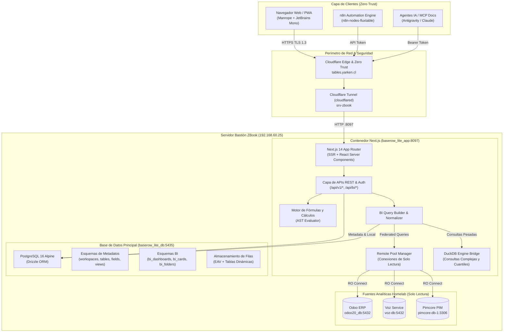

# 🏛️ FluxTable - Manual de Arquitectura de Sistema

> **Plataforma de Datos & Business Intelligence | Sistema Yarken**  
> *Versión 2.0 (Edición Cobalto) - Fecha: 2026-11-17*  
> *Host de Producción: srv-zbook (`192.168.60.25:8097`) | Dominio: `https://tables.yarken.cl`*

---

## 1. Visión General y Objetivos Arquitectónicos

FluxTable nace con el propósito de unificar en una única plataforma de altísimo desempeño y costo cero en licencias dos necesidades críticas del ecosistema Yarken:
1. **Gestión Operativa de Datos No-Code / Low-Code**: Sustituir instancias pesadas de Baserow tradicional (eliminando dependencias de Django, Celery, Redis, Caddy y contenedores de más de 3.5 GB de RAM).
2. **Motor Analítico y Business Intelligence (BI)**: Reemplazar Metabase (`:3100`), absorbiendo la visualización de KPIs, comparaciones temporales (MoM, YoY), gráficos interactivos, tableros ejecutivos y alertas automatizadas, consumiendo menos del 10% de los recursos de cómputo originales.

### Principios Rectores
- **Cero Licencias**: 100% código abierto y propietario Yarken, sin limitaciones de usuarios, filas o funcionalidades corporativas.
- **Eficiencia Extrema de Recursos**: Huella de memoria inferior a 150 MiB en operación normal y consumo de CPU en reposo cercano a 0%.
- **Seguridad en Profundidad**: Aislamiento estricto por Workspaces, sanitización defensiva de consultas analíticas (bloqueo preventivo de mutaciones DDL/DML) y publicación protegida mediante Cloudflare Zero Trust.
- **Diseño Transversal Brandbook Cobalto**: Cumplimiento del estándar visual Yarken v2 con tipografía dual (`Manrope` + `JetBrains Mono`) y paleta Cobalto (`#1D5BD8`).

---

## 2. Diagrama de Arquitectura de Alto Nivel

---

## 3. Componentes del Sistema

### 3.1. Frontend y Capa de Presentación (Next.js 14 + Tailwind)
- **Framework**: Next.js 14 con arquitectura de App Router (`/app`), combinando React Server Components (RSC) para renderizado rápido de metadatos y Client Components para interactividad reactiva en tablas y gráficos.
- **Design System «Cobalto»**:
  - Color de lienzo: `bg` (`#F7F8FA`) que otorga profundidad a los paneles.
  - Tarjetas y contenedores: `surface` (`#FFFFFF`) con bordes en `line` (`#E4E7EC`).
  - Acento dinámico: Cobalto `#1D5BD8` y derivados.
  - Tipografía: `Manrope` para controles, modales y textos; `JetBrains Mono` con soporte `tabular-nums` para métricas KPI y marcas de tiempo.
- **Librería de Gráficos**: Recharts embebido con paletas monocromáticas y de contraste Cobalto, garantizando renderizado vectorial SVG responsive sin caídas de framerate.

### 3.2. Motor de Base de Datos y Persistencia Local
- **Motor**: PostgreSQL 16 sobre Alpine Linux, administrado mediante **Drizzle ORM**.
- **Esquema Híbrido**:
  - Estructuras relacionales normalizadas para metadatos (`workspaces`, `applications`, `tables`, `fields`, `views`, `bi_dashboards`, `bi_cards`).
  - Capa de datos flexible: filas almacenadas con control de tipos estricto validado en runtime mediante TypeScript y esquemas JSONB indexados mediante GIN para filtros de alto rendimiento.

### 3.3. Motor de BI & Analítica In-Memory
- **Query Builder Parametrizado**:
  - Transforma configuraciones visuales (métrica, agrupación, filtros, comparativa temporal) en consultas SQL nativas altamente optimizadas.
  - Intercepción preventiva DDL/DML: todo intento de mutación (`INSERT`, `UPDATE`, `DELETE`, `DROP`, `ALTER`, etc.) es neutralizado respondiendo `HTTP 403`.
  - Sanitización estricta de nombres de columnas y parámetros obligatorios (`$1, $2...`) para evitar SQL Injection.
- **Remote Pool Manager**:
  - Mantiene pools de conexiones independientes hacia bases de datos externas (`Odoo ERP`, `Voz Service`, `Pimcore`).
  - Solo permite usuarios y credenciales de solo lectura (`baserow_ro`).
  - Timeouts estrictos (5000 ms por consulta) para evitar saturación de bases transaccionales.
- **DuckDB Bridge**:
  - Motor embebido para cálculos estadísticos intensivos (medianas exactas, percentiles p90/p99, regresiones lineales) sin penalizar el rendimiento del servidor transaccional PostgreSQL.

### 3.4. Motor de Fórmulas
- Parser de expresiones basado en Árbol de Sintaxis Abstracta (AST).
- Admite operaciones matemáticas (`+`, `-`, `*`, `/`, `^`), lógicas (`IF`, `AND`, `OR`, `NOT`), funciones de texto (`CONCAT`, `UPPER`, `LOWER`, `TRIM`, `REGEX_REPLACE`) y manipulación temporal (`DATE_ADD`, `DIFF_DAYS`, `NOW`).
- Evaluación segura sin uso de `eval()` ni llamadas reflexivas a JavaScript.

---

## 4. Topología de Red y Seguridad

| Segmento / Capa | Componente | Protocolo / Puerto | Políticas de Seguridad |
| :--- | :--- | :--- | :--- |
| **Pública** | Cloudflare Edge | HTTPS :443 (TLS 1.3) | WAF, DDoS protection, Zero Trust Access |
| **Ingreso Homelab** | Cloudflare Tunnel | QUIC / HTTP2 | Sin puertos abiertos hacia Internet en el router |
| **LAN Interna** | `baserow_lite_app` | HTTP :8097 / :3000 | Conexión interna Docker; solo expuesto al túnel |
| **Base Local** | `baserow_lite_db` | PostgreSQL :5435 | Aislado en red puente Docker; credenciales en 1P |
| **Redes Externas** | `odoo20_net`, `voz_net` | PostgreSQL :5432 | Redes Docker bridge compartidas con usuarios `RO` |

---

## 5. Resumen de Desempeño y Capacidad

Las pruebas de estrés y certificación ácida ([Issue #21](https://github.com/snadales/BaserowLite/issues/21)) demostraron las siguientes capacidades operativas:
- **Throughput Máximo**: 518.5 consultas por segundo.
- **Latencia p50**: 91.4 milisegundos bajo concurrencia extrema (50 hilos concurrentes).
- **Estabilidad de Memoria**: Variación de RAM inferior a +2.15 MiB tras 500 consultas analíticas consecutivas.
- **Cero Fugas**: Sin acumulación de objetos ni pérdidas de descriptores de archivos.
