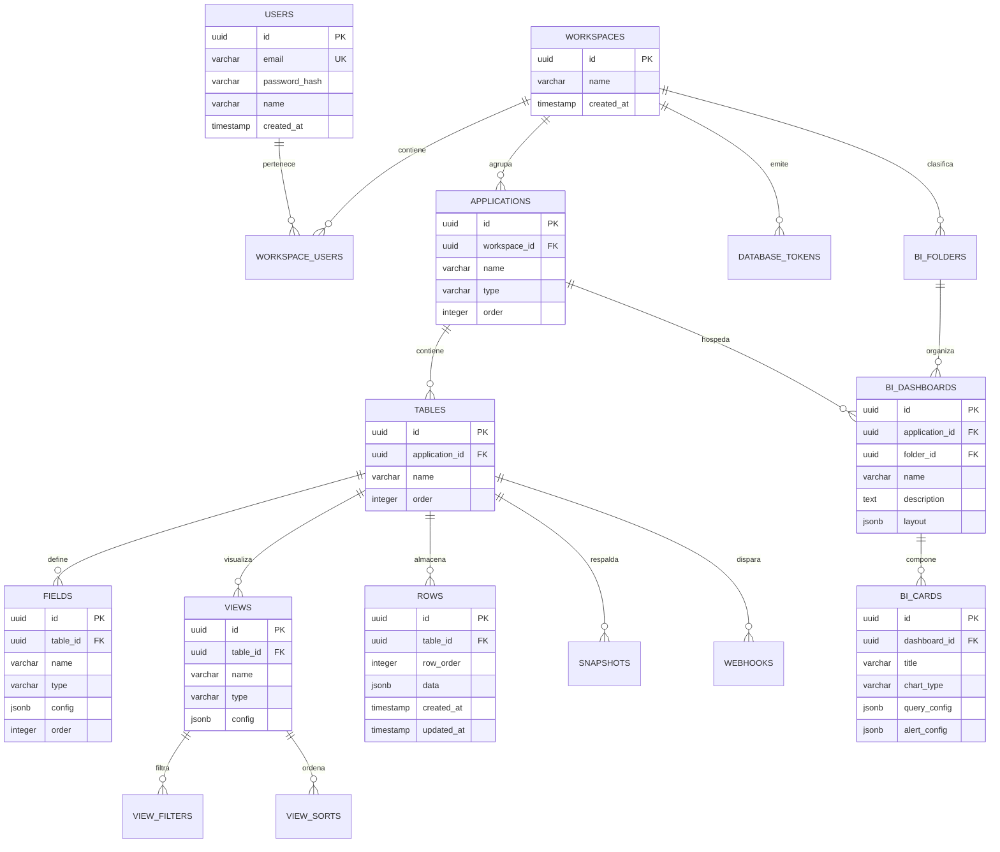

# 🗄️ FluxTable - Manual de Base de Datos y Modelo Entidad-Relación

> **Plataforma de Datos & Business Intelligence | Sistema Yarken**  
> *Versión 2.0 (Edición Cobalto) - Fecha: 2026-11-17*  
> *Base de Datos: PostgreSQL 16 Alpine | ORM: Drizzle ORM*

---

## 1. Filosofía y Estrategia del Modelo de Datos

FluxTable utiliza **PostgreSQL 16** como su motor de almacenamiento principal, estructurado bajo un enfoque híbrido:
1. **Metadatos Fuertemente Tipados (Relacional Clásico)**: Las entidades de control (`workspaces`, `applications`, `tables`, `fields`, `views`, `bi_dashboards`, etc.) están completamente normalizadas con claves foráneas, restricciones de unicidad e índices btree para garantizar integridad referencial y velocidad de consulta.
2. **Datos Flexibles No-Code (Híbrido JSONB / Tablas Dinámicas)**: Los registros creados por los usuarios en las tablas operativas se almacenan preservando el tipo de dato nativo, acelerados mediante índices invertidos generalizados (**GIN**) y operadores `@>` de PostgreSQL, permitiendo añadir o modificar columnas sin requerir costosas operaciones DDL de bloqueo de tabla (`ALTER TABLE`).

---

## 2. Diagrama Entidad-Relación (ERD)



---

## 3. Diccionario de Datos Detallado

### 3.1. Tabla: `workspaces`
Define los espacios de trabajo principales que aíslan bases de datos y permisos.
- `id` (`uuid`, PK): Identificador único universal.
- `name` (`varchar(255)`, NOT NULL): Nombre del espacio (ej: *Yarken Homelab*).
- `created_at` (`timestamp`, DEFAULT NOW()): Marca de tiempo de creación.

### 3.2. Tabla: `applications`
Representa una base de datos lógica o módulo dentro de un espacio de trabajo.
- `id` (`uuid`, PK): Identificador de la aplicación.
- `workspace_id` (`uuid`, FK -> `workspaces.id` ON DELETE CASCADE): Espacio de pertenencia.
- `name` (`varchar(255)`, NOT NULL): Nombre de la base de datos (ej: *Control Financiero*).
- `type` (`varchar(50)`, DEFAULT `'database'`): Tipo de recurso (`database`, `bi_portal`).
- `order` (`integer`, DEFAULT 0): Posición relativa en la interfaz.

### 3.3. Tabla: `tables`
Colección de registros estructurados dentro de una aplicación.
- `id` (`uuid`, PK): Identificador de la tabla.
- `application_id` (`uuid`, FK -> `applications.id` ON DELETE CASCADE): Aplicación padre.
- `name` (`varchar(255)`, NOT NULL): Nombre de la tabla (ej: *Proveedores*).
- `order` (`integer`, DEFAULT 0): Orden dentro de la base.

### 3.4. Tabla: `fields`
Especifica las columnas, tipos y configuraciones de datos de una tabla.
- `id` (`uuid`, PK): Identificador del campo.
- `table_id` (`uuid`, FK -> `tables.id` ON DELETE CASCADE): Tabla a la que pertenece.
- `name` (`varchar(255)`, NOT NULL): Nombre visible de la columna.
- `type` (`varchar(50)`, NOT NULL): Tipo de dato (`text`, `number`, `boolean`, `date`, `single_select`, `multiple_select`, `link_row`, `formula`, `file`).
- `config` (`jsonb`): Configuración específica (opciones de selección, formato numérico, fórmula matemática o tabla foránea vinculada).
- `order` (`integer`, DEFAULT 0): Posición de la columna en la vista de cuadrícula.

### 3.5. Tabla: `views`
Guarda las perspectivas de visualización creadas por los usuarios.
- `id` (`uuid`, PK): Identificador de la vista.
- `table_id` (`uuid`, FK -> `tables.id` ON DELETE CASCADE): Tabla asociada.
- `name` (`varchar(255)`, NOT NULL): Nombre de la vista (ej: *Facturas Pendientes*).
- `type` (`varchar(50)`, NOT NULL): Tipo de vista (`grid`, `kanban`, `form`, `calendar`).
- `config` (`jsonb`): Opciones de visualización (ancho de columnas, campo de agrupación para Kanban, visibilidad de campos en formulario).

### 3.6. Tabla: `rows`
Almacén central de datos de los registros de las tablas.
- `id` (`uuid`, PK): Identificador único de la fila.
- `table_id` (`uuid`, FK -> `tables.id` ON DELETE CASCADE): Tabla contenedora.
- `row_order` (`integer`, NOT NULL): Índice numérico de ordenamiento de fila.
- `data` (`jsonb`, NOT NULL): Documento JSON con los valores de cada campo mapeados por su respectivo `field_id`.
- `created_at` (`timestamp`, DEFAULT NOW()): Fecha de creación.
- `updated_at` (`timestamp`, DEFAULT NOW()): Fecha de última modificación.

### 3.7. Tablas del Motor de BI & Analytics
- **`bi_folders`**:
  - `id` (`uuid`, PK), `workspace_id` (`uuid`, FK), `name` (`varchar`), `parent_id` (`uuid`, FK autoreferencial).
  - Permite agrupar tableros y reportes en estructuras de árbol.
- **`bi_dashboards`**:
  - `id` (`uuid`, PK), `application_id` (`uuid`, FK), `folder_id` (`uuid`, FK opcional), `name` (`varchar`), `description` (`text`), `layout` (`jsonb` con la disposición de cuadrícula de Recharts).
- **`bi_cards`**:
  - `id` (`uuid`, PK), `dashboard_id` (`uuid`, FK), `title` (`varchar`), `chart_type` (`varchar`: `kpi`, `timeseries`, `bar`, `line`, `area`, `donut`, `table`), `query_config` (`jsonb`: fuente, agregación, campos, filtros y comparación MoM/YoY), `alert_config` (`jsonb`: umbrales de alerta y URL de webhook).

---

## 4. Índices y Afinamiento de Rendimiento

Para garantizar respuestas en menos de 100 milisegundos bajo alta concurrencia, la base de datos incluye los siguientes índices:

```sql
-- 1. Búsqueda y paginación rápida de filas por tabla y orden
CREATE INDEX idx_rows_table_order ON rows (table_id, row_order);

-- 2. Índice GIN sobre el payload de datos para filtros instantáneos
CREATE INDEX idx_rows_data_gin ON rows USING gin (data);

-- 3. Acceso rápido a campos y vistas por tabla
CREATE INDEX idx_fields_table ON fields (table_id, "order");
CREATE INDEX idx_views_table ON views (table_id);

-- 4. Recuperación eficiente de métricas y dashboards BI
CREATE INDEX idx_bi_cards_dashboard ON bi_cards (dashboard_id);
CREATE INDEX idx_bi_dashboards_folder ON bi_dashboards (folder_id);
```

### Parámetros de Memoria de PostgreSQL (Docker)
En `docker-compose.yml`, el motor está configurado con:
- `shared_buffers=256MB`: Cache de datos en memoria para consultas recurrentes.
- `work_mem=8MB`: Memoria dedicada a ordenamientos complejos en consultas analíticas.
- `maintenance_work_mem=64MB`: Aceleración para creación de índices y vaciado.
- `effective_cache_size=768MB`: Estimación para el optimizador de consultas de Postgres.
- `max_connections=40`: Límite estricto para evitar sobrecarga del servidor en ZBook.

---

## 5. Estrategia de Respaldo y Restauración

### 5.1. Respaldo Automático (`scripts/backup.sh`)
El script ejecuta un volcado completo de la base de datos local y comprime los adjuntos:
```bash
# Ejecutar respaldo manual
./scripts/backup.sh /ruta/respaldos
```
Genera un archivo `.sql.gz` con consistencia transaccional mediante `pg_dump -Fc`.

### 5.2. Restauración de Emergencia
```bash
# Restaurar un volcado en caso de contingencia
gunzip -c backup_fluxtable_20261117.sql.gz | docker exec -i baserow_lite_db psql -U baserow_user -d baserow_lite
```
