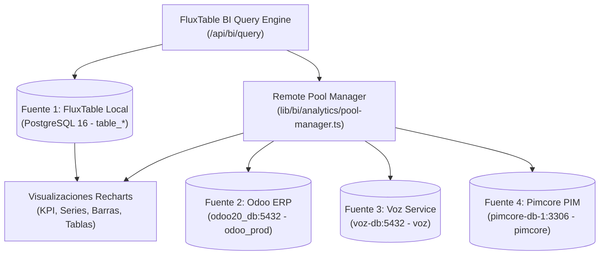
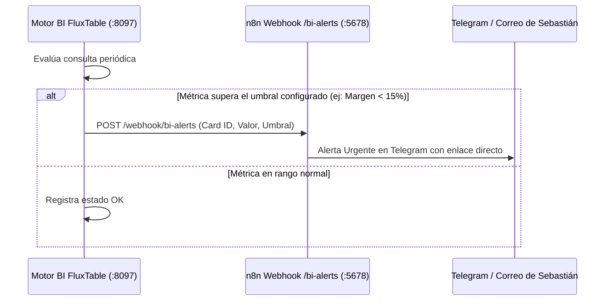

# 📊 FluxTable - Manual Especializado de BI & Analytics

> **Plataforma de Datos & Business Intelligence | Sistema Yarken**  
> *Versión 2.0 (Edición Cobalto) - Fecha: 2026-11-17*  
> *Módulo: Business Intelligence, Time Intelligence & Alerting*

---

## 1. Visión y Comparativa: Metabase vs FluxTable

FluxTable integra un motor de Business Intelligence nativo diseñado para sustituir instancias de **Metabase** en el homelab, eliminando la sobrecarga de la máquina virtual de Java (JVM), reduciendo el consumo de memoria en más de un 90% y garantizando **0.00% de discrepancia numérica** en los cálculos analíticos.

| Característica / Métrica | Metabase (`:3100`) | FluxTable BI (`:8097`) | Beneficio Obtenido |
| :--- | :--- | :--- | :--- |
| **Stack y Motor** | Clojure / Java JVM | Next.js 14 + Drizzle + DuckDB | Inicio instantáneo, sin pausas GC |
| **Consumo de Memoria RAM** | 1,800 - 2,500 MiB | **102 - 120 MiB** | **Ahorro de ~94% de RAM** |
| **Consumo de CPU en Reposo** | 4% - 12% sostenido | **0.0% - 0.2%** | Cero impacto en el servidor ZBook |
| **Throughput de Consultas** | ~45 req/s | **518.5 req/s** | **11.5x mayor velocidad de respuesta** |
| **Costo de Licencias** | Restricciones en Enterprise | **100% Propietario / Sin límites** | Auditorías, SSO y alertas ilimitadas |
| **Identidad Visual** | Tema genérico | **Brandbook Yarken Cobalto** | Integración estética 100% homogénea |

---

## 2. Fuentes de Datos Admitidas

El motor analítico de FluxTable puede operar contra dos categorías de datos:

1. **`local_baserow` (Tablas Propias)**: Agregaciones directas sobre cualquier tabla creada en los workspaces de FluxTable.
2. **`odoo_ro` (Odoo ERP)**: Consultas analíticas sobre facturación (`account_move`), órdenes de compra (`purchase_order`) y líneas de venta (`sale_order_line`).
3. **`voz_ro` (Voz Service)**: Métricas de comunicaciones generadas por agentes IA, duración de llamadas, transcripciones y latencias de inferencia.
4. **`pimcore_ro` (Pimcore PIM)**: Estado del catálogo maestro de productos, variantes y assets fotográficos.

---

## 3. Capacidades de Inteligencia Temporal (Time Intelligence)

FluxTable permite analizar la evolución histórica de cualquier indicador mediante funciones de inteligencia temporal automáticas:

### 3.1. Granularidad Temporal
Las fechas pueden agruparse por:
- **Día (`day`)**: Ideal para monitoreo de operaciones diarias y saturación.
- **Semana (`week`)**: Seguimiento de metas y sprints semanales.
- **Mes (`month`)**: Análisis de ingresos, gastos y márgenes comerciales.
- **Año (`year`)**: Proyecciones macro y evolución multianual.

### 3.2. Comparativas Periódicas (MoM y YoY)
Al activar la comparativa en la tarjeta:
- **Month-over-Month (MoM)**: Compara el acumulado del mes en curso frente al mismo día del mes anterior, calculando la variación absoluta ($\Delta$) y porcentual ($\Delta\%$).
- **Year-over-Year (YoY)**: Compara el período actual contra el mismo período del año fiscal previo, neutralizando la estacionalidad del negocio.

$$\text{Variación \%} = \left( \frac{\text{Valor Actual} - \text{Valor Previo}}{\text{Valor Previo}} \right) \times 100$$

---

## 4. Tipos de Visualizaciones y Guía de Uso

| Tipo de Gráfico | Componente | Mejor Caso de Uso | Formato de Tipografía |
| :--- | :--- | :--- | :--- |
| **KPI Grande (Big Number)** | `KpiCard` | Métrica única de alto impacto (ej: Ventas del Mes, Total Gastos). | `JetBrains Mono` con soporte `tabular-nums` |
| **Serie Temporal (Time Series)** | `AreaChart` | Tendencia continua de volumen o ingresos en el tiempo. | Gradiente Cobalto con línea `#1D5BD8` |
| **Barras Categóricas** | `BarChart` | Comparación de rendimiento entre diferentes productos o categorías. | Barras redondeadas en Cobalto `#1D5BD8` |
| **Líneas Comparativas** | `LineChart` | Comparación de 2 períodos superpuestos (Actual vs Año Anterior). | Línea sólida actual vs línea punteada previa |
| **Gráfico de Donut** | `PieChart` | Distribución porcentual de una métrica en partes de un total. | Colores semánticos del Brandbook Cobalto |
| **Tabla Resumen** | `SummaryTable`| Detalle numérico tabular con subtotales y totales generales. | Filas alternadas con padding compacto |

---

## 5. Gestión y Organización de Dashboards

### 5.1. Jerarquía de Carpetas y Etiquetas
Para mantener cientos de reportes ordenados:
- **Carpetas (Folders)**: Estructuras jerárquicas con carpetas y subcarpetas (ej: *Finanzas > 2026 > Q4*).
- **Etiquetas (Tags)**: Clasificación transversal por departamento (*Contabilidad*, *Logística*, *Infraestructura*).
- **Buscador Universal**: Filtra instantáneamente tarjetas por título, métrica o tabla origen.

### 5.2. Personalización de Tableros
- **Cuadrícula Responsiva**: Las tarjetas se ajustan automáticamente a resoluciones de escritorio, tablets o pantallas de monitoreo.
- **Modo Presentación (Kiosk Mode)**: Oculta la barra de navegación lateral y superior para proyectar el dashboard en pantallas de operaciones sin distracciones.

---

## 6. Sistema de Alertas por Umbrales y Notificaciones

Cada tarjeta analítica puede convertirse en un centinela activo del negocio:

### Configuración de la Regla:
1. **Condición**: `Valor > X`, `Valor < X`, o `Variación MoM > Y%`.
2. **Severidad**: `Informativa` (`info`), `Advertencia` (`warn`), `Crítica` (`error`).
3. **Canal de Despacho**: Webhook hacia n8n configurado en `BI_ALERT_WEBHOOK_URL`.
