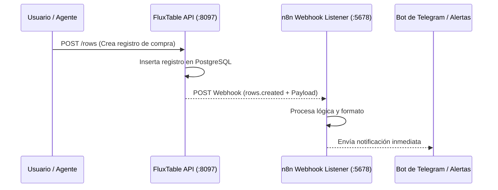

# 🔌 FluxTable - Manual de Integración, APIs y Automatizaciones

> **Plataforma de Datos & Business Intelligence | Sistema Yarken**  
> *Versión 2.0 (Edición Cobalto) - Fecha: 2026-11-17*  
> *Host de Producción: srv-zbook (`https://fluxtable.yarken.cl`)*

---

## 1. Visión General de Integración

FluxTable está diseñado para actuar como una fuente central de verdad extensible e interoperable dentro del ecosistema Yarken Homelab. Permite la integración bidireccional mediante:
1. **API REST de Alto Desempeño**: Para operaciones CRUD individuales o por lotes (batching masivo de hasta 1,000 registros).
2. **Webhooks Salientes**: Notificación instantánea orientada a eventos hacia n8n, bots de Telegram o microservicios.
3. **Nodo Comunitario Custom para n8n (`n8n-nodes-fluxtable`)**: Bloque visual nativo para orquestar flujos sin escribir código.
4. **Pool Manager Multi-Base**: Capacidad de consulta federada de solo lectura sobre bases de datos de Odoo ERP, Voz Service y Pimcore PIM.

---

## 2. Autenticación y Credenciales

Las llamadas a la API de FluxTable se autentican mediante **Database Tokens**.

### Generación de Token
1. Acceda a la interfaz web de FluxTable.
2. Ingrese a **Ajustes de Usuario** (`My Settings`) > **Tokens de Base de Datos** (`Database Tokens`).
3. Cree un nuevo token asignando los permisos requeridos (*Lectura*, *Escritura*, *Creación de Esquemas*).
4. Guarde el token secreto resultante en la bóveda `IA` de **1Password** (`op://IA/FluxTable/api_token`).

### Encabezado HTTP Obligatorio
```http
Authorization: Token <TU_DATABASE_TOKEN>
Content-Type: application/json
```

---

## 3. Especificación de la API REST

### 3.1. Consultar Filas de una Tabla
`GET /api/v1/database/tables/{table_id}/rows`

**Parámetros de Consulta (Query Params):**
- `page` (int, default `1`): Número de página.
- `size` (int, default `100`, max `1000`): Registros por página.
- `search` (string, opcional): Búsqueda textual sobre campos indexados.
- `order_by` (string, opcional): Campo de ordenación (`+field_id` ascendente, `-field_id` descendente).

**Respuesta de Ejemplo (`HTTP 200 OK`):**
```json
{
  "count": 1420,
  "page": 1,
  "totalPages": 15,
  "results": [
    {
      "id": "e4f8a123-5c21-4f9e-b2d4-1a9823f6e1b2",
      "row_order": 1,
      "field_101": "Servidor ZBook",
      "field_102": 1850000,
      "field_103": "Activo",
      "created_at": "2026-11-17T10:15:30Z"
    }
  ]
}
```

### 3.2. Creación Masiva por Lotes (Batch Insert)
`POST /api/v1/database/tables/{table_id}/rows/batch`

Permite insertar hasta 1,000 registros en una única transacción atómica.

**Payload:**
```json
{
  "items": [
    { "field_101": "Switch Unifi 24p", "field_102": 320000, "field_103": "Stock" },
    { "field_101": "Router Mikrotik", "field_102": 195000, "field_103": "En Uso" }
  ]
}
```

**Respuesta de Ejemplo (`HTTP 201 Created`):**
```json
{
  "inserted": 2,
  "items": [
    { "id": "uuid-1", "row_order": 2 },
    { "id": "uuid-2", "row_order": 3 }
  ]
}
```

### 3.3. Ejecución de Consultas BI y Agregaciones
`POST /api/bi/query`

Endpoint del motor analítico para generar agregaciones en tiempo real sin saturar la base.

**Payload:**
```json
{
  "source": "local_baserow",
  "table": "table_finanzas",
  "metrics": [
    { "field": "monto", "aggregation": "SUM", "alias": "gasto_total" }
  ],
  "groupBy": ["categoria"],
  "filters": [
    { "field": "fecha", "operator": "gte", "value": "2026-01-01" }
  ]
}
```

---

## 4. Webhooks Salientes y Disparo de Eventos

FluxTable permite configurar webhooks salientes por tabla para alertar a sistemas externos ante cualquier mutación:



### Eventos Soportados
- `rows.created`: Emitido cuando se inserta una o más filas.
- `rows.updated`: Emitido al modificar valores de celdas.
- `rows.deleted`: Emitido cuando una fila es purgada.

### Estructura del Payload de Webhook
```json
{
  "event": "rows.created",
  "table_id": "9b1deb4d-3b7d-4bad-9bdd-2b0d7b3dcb6d",
  "timestamp": "2026-11-17T14:30:00Z",
  "items": [
    {
      "id": "e4f8a123-5c21-4f9e-b2d4-1a9823f6e1b2",
      "data": {
        "field_101": "Compra Insumos",
        "field_102": 45000
      }
    }
  ]
}
```

---

## 5. Nodo Custom para n8n (`n8n-nodes-fluxtable`)

El repositorio incluye el paquete oficial [`packages/n8n-nodes-fluxtable`](file:///Users/snadales/Dev/01_Homelab/07_BaserowLite/packages/n8n-nodes-fluxtable) para integrar n8n directamente.

### 5.1. Componentes del Paquete
- **`FluxTableApi.credentials.ts`**: Gestiona la autenticación con la URL base (`https://fluxtable.yarken.cl`) y el Database Token.
- **`FluxTable.node.ts`**: Nodo de acción con soporte para:
  - **Recursos**: `Row`, `Field` (Esquema), `Snapshot` (Respaldo) y `Table`.
  - **Operaciones**: `Create`, `Get`, `Get Many` (con paginación automática), `Update`, `Delete` y `Batch Create`.
- **`FluxTableTrigger.node.ts`**: Receptor webhook en tiempo real para disparar flujos ante cambios en tablas.
- **`fluxtable.svg`**: Logotipo vectorial con la Lechuza-Y oficial del Brandbook Cobalto.

### 5.2. Despliegue en n8n
El paquete compilado en `packages/n8n-nodes-fluxtable/dist` se monta como volumen en el contenedor de n8n en ZBook:
```yaml
# En docker-compose de n8n
volumes:
  - /home/snadales/docker/fluxtable/packages/n8n-nodes-fluxtable:/home/node/.n8n/custom/n8n-nodes-fluxtable:ro
```

---

## 6. Conexión de Solo Lectura a Fuentes Externas

FluxTable incluye pools de conexión gestionados en `lib/bi/analytics/pool-manager.ts` hacia servicios clave del homelab:

| Fuente | Driver | Contenedor ZBook | Puerto | Credencial (1Password) |
| :--- | :--- | :--- | :--- | :--- |
| **Odoo ERP** | PostgreSQL | `odoo20_db` | 5432 | `op://IA/FluxTable/bi_odoo_ro_password` |
| **Voz Service** | PostgreSQL | `voz-db` | 5432 | `op://IA/FluxTable/bi_voz_ro_password` |
| **Pimcore PIM** | MariaDB | `pimcore-db-1` | 3306 | `op://IA/FluxTable/bi_pimcore_ro_password` |

*Nota de Seguridad:* Todas las conexiones externas utilizan usuarios dedicados con privilegios exclusivos `SELECT` sobre esquemas específicos, imposibilitando cualquier alteración en las bases de datos de producción.
