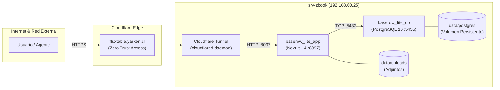

# 🚢 FluxTable - Manual de Operaciones, Despliegue y Runbook

> **Plataforma de Datos & Business Intelligence | Sistema Yarken**  
> *Versión 2.0 (Edición Cobalto) - Fecha: 2026-11-17*  
> *Servidor: srv-zbook (`192.168.60.25:8097`) | Dominio: `https://fluxtable.yarken.cl`*

---

## 1. Topología de Despliegue en Producción

FluxTable está desplegado en el servidor bastión central **srv-zbook** (Ubuntu 24.04 LTS, VLAN 60) mediante contenedores Docker orquestados con **Docker Compose**:



---

## 2. Configuración de Recursos y Límites Docker

Para garantizar que FluxTable no compita agresivamente por recursos con el stack de IA (LiteLLM, Ollama, Qdrant) en ZBook, se aplican límites estrictos en `docker-compose.yml`:

| Contenedor | Imagen | Puerto Host | Límite RAM | Reserva RAM | Health Check |
| :--- | :--- | :--- | :--- | :--- | :--- |
| **`baserow_lite_app`** | `Dockerfile` (Node.js 20 Alpine) | `8097:3000` | 1024 MB | 256 MB | `wget /api/health` |
| **`baserow_lite_db`** | `postgres:16-alpine` | `5435:5432` | 1024 MB | 384 MB | `pg_isready` |

---

## 3. Despliegue y Actualización Paso a Paso

El despliegue en ZBook se gestiona de forma no interactiva a través del bastión:

### 3.1. Procedimiento de Actualización de Código
```bash
# 1. Conectarse a ZBook y situarse en el directorio del servicio
ssh zbook "cd /home/snadales/docker/baserow-lite && git pull origin main"

# 2. Reconstruir la imagen de la aplicación
ssh zbook "cd /home/snadales/docker/baserow-lite && docker compose build app"

# 3. Levantar el nuevo contenedor sin tiempo de inactividad
ssh zbook "cd /home/snadales/docker/baserow-lite && docker compose up -d app"

# 4. Verificar salud del contenedor
ssh zbook "docker ps --filter name=baserow_lite --format 'table {{.Names}}\t{{.Status}}\t{{.Ports}}'"
```

### 3.2. Verificación de Respuesta HTTP
```bash
# Verificar código de estado y título de la aplicación
curl -sI http://192.168.60.25:8097/ | head -n 5
curl -s http://192.168.60.25:8097/ | grep -i '<title>'
```

---

## 4. Gestión Segura de Secretos (1Password Connect)

FluxTable sigue la regla de oro del Sistema Yarken: **ningún secreto se almacena en texto plano**.

Todos los secretos residen en la bóveda `IA` de **1Password** y se inyectan en tiempo de ejecución:
- `APP_SECRET`: Firma criptográfica de sesiones y cookies (`op://IA/FluxTable/app_secret`).
- `POSTGRES_PASSWORD`: Credencial de la base de datos principal (`op://IA/FluxTable/postgres_password`).
- `BI_ODOO_RO_PASSWORD`: Acceso de solo lectura a Odoo ERP (`op://IA/FluxTable/bi_odoo_ro_password`).
- `BI_VOZ_RO_PASSWORD`: Acceso de solo lectura al microservicio de Voz (`op://IA/FluxTable/bi_voz_ro_password`).

---

## 5. Telemetría y Monitoreo

### 5.1. Endpoint de Monitoreo (`/api/health`)
Devuelve el estado operativo de los subsistemas en formato JSON:
```bash
curl -s http://192.168.60.25:8097/api/health | jq .
```
```json
{
  "status": "healthy",
  "uptime": 14520,
  "database": {
    "status": "connected",
    "latencyMs": 1.2
  },
  "memory": {
    "rssMb": 104.5,
    "heapUsedMb": 68.2
  }
}
```

### 5.2. Métricas en Tiempo Real (Netdata & Docker)
- Monitoreo en vivo de CPU y memoria:
  ```bash
  ssh zbook "docker stats --no-stream baserow_lite_app baserow_lite_db"
  ```

---

## 6. Runbook de Operaciones y Resolución de Incidentes

### Incidente 1: La aplicación responde `HTTP 502 Bad Gateway`
- **Diagnóstico**: El proceso Node.js puede haber caído o la base de datos no está respondiendo.
- **Acción**:
  1. Revisar los últimos logs: `ssh zbook "docker logs baserow_lite_app --tail 50"`
  2. Verificar estado de la base de datos: `ssh zbook "docker exec -i baserow_lite_db pg_isready"`
  3. Si la base de datos está saludable, reiniciar la aplicación: `ssh zbook "docker compose restart app"`

### Incidente 2: Fuga de memoria o reinicio por OOM (`Out of Memory`)
- **Diagnóstico**: Alguna consulta analítica masiva no agrupada superó los límites asignados.
- **Acción**:
  1. Verificar el consumo en Docker: `ssh zbook "docker stats --no-stream baserow_lite_app"`
  2. Confirmar que el motor DuckDB/Postgres liberó descriptores tras la consulta.
  3. Revisar en `app/api/bi/query/route.ts` que el parámetro `limit` máximo de 10,000 registros esté activo.

### Incidente 3: Bloqueo de Conexiones en PostgreSQL (`too many connections`)
- **Diagnóstico**: Clientes externos o agentes abrieron pools sin cerrarlos.
- **Acción**:
  1. Consultar conexiones activas:
     ```sql
     SELECT count(*), state FROM pg_stat_activity GROUP BY state;
     ```
  2. Terminar conexiones inactivas colgadas:
     ```sql
     SELECT pg_terminate_backend(pid) FROM pg_stat_activity WHERE state = 'idle' AND state_change < now() - interval '5 minutes';
     ```

### Incidente 4: Procedimiento de Rollback
En caso de fallo crítico tras un despliegue:
```bash
# Revertir al commit anterior en ZBook
ssh zbook "cd /home/snadales/docker/baserow-lite && git checkout HEAD~1 && docker compose build app && docker compose up -d app"
```
