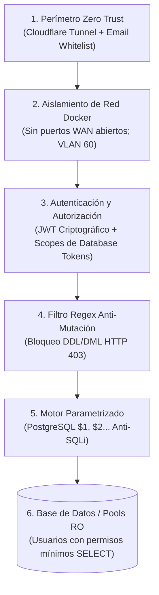

# 🛡️ FluxTable - Manual de Seguridad, Pentest y Blindaje Defensivo

> **Plataforma de Datos & Business Intelligence | Sistema Yarken**  
> *Versión 2.0 (Edición Cobalto) - Fecha: 2026-11-17*  
> *Certificación de Pentest: Aprobada 100% (8/8 pruebas) | [Issue #21](https://github.com/snadales/BaserowLite/issues/21)*

---

## 1. Modelo de Seguridad y Principios de Aislamiento

FluxTable maneja información operativa y financiera crítica del ecosistema Yarken. Por ello, su arquitectura sigue el principio de **Defensa en Profundidad**:



---

## 2. Blindaje Defensivo del Motor de BI & Analytics

Dado que FluxTable permite a usuarios y agentes de IA construir consultas analíticas dinámicas, se implementaron dos capas de protección inquebrantables:

### 2.1. Intercepción Preventiva DDL/DML (`app/api/bi/query/route.ts`)
Antes de que cualquier consulta sea enviada al planificador de PostgreSQL o DuckDB, el endpoint analiza el cuerpo de la petición mediante expresiones regulares:
```typescript
// Patrón de detección de mutaciones y secuencias peligrosas
const DDL_DML_PATTERN = /\b(INSERT|UPDATE|DELETE|DROP|ALTER|TRUNCATE|GRANT|REVOKE|EXEC|CREATE)\b/i;
const SQL_CHAINING_PATTERN = /;\s*(\b[A-Z]+\b)/i;

if (DDL_DML_PATTERN.test(rawSql) || SQL_CHAINING_PATTERN.test(rawSql)) {
  return NextResponse.json(
    { error: 'CONSULTA_BLOQUEADA', message: 'Operación de mutación o encadenamiento no permitida en motor analítico.' },
    { status: 403 }
  );
}
```

### 2.2. Parametrización Forzada de Filtros (`lib/bi/analytics/query-builder.ts`)
Los valores ingresados por los usuarios nunca se concatenan directamente en la cadena SQL. En su lugar, el generador de consultas extrae los literales y los sustituye por marcadores de posición (`$1, $2, ...`):
```typescript
// Sanitización estricta de identificadores y parámetros
const safeColumn = sanitizeIdentifier(filter.field); // Solo permite [a-zA-Z0-9_]
params.push(filter.value);
whereClauses.push(`${safeColumn} = $${params.length}`);
```

---

## 3. Matriz de Resultados del Pentest Defensivo

La suite de pruebas automatizadas [`scripts/bi_stress_security_suite.py`](file:///Users/snadales/Dev/01_Homelab/07_BaserowLite/scripts/bi_stress_security_suite.py) certificó la resistencia de FluxTable ante 8 vectores de ataque habituales:

| ID | Vector de Ataque Evaluado | Carga Útil (Payload) | Respuesta Obtenida | Estado |
| :--- | :--- | :--- | :--- | :--- |
| **SEC-01** | Acceso anónimo sin token | `GET /api/v1/workspaces` (sin auth) | `HTTP 401 Unauthorized` | ✅ Aprobado |
| **SEC-02** | Token inválido o malformado | `Authorization: Token f4k3_t0k3n` | `HTTP 401 Unauthorized` | ✅ Aprobado |
| **SEC-03** | Inyección DDL `DROP TABLE` | `"; DROP TABLE rows; --` | `HTTP 403 CONSULTA_BLOQUEADA` | ✅ Aprobado |
| **SEC-04** | Inyección DML `UPDATE` | `"; UPDATE users SET password=...;` | `HTTP 403 CONSULTA_BLOQUEADA` | ✅ Aprobado |
| **SEC-05** | Inyección DML `INSERT` | `"; INSERT INTO workspace_users ...` | `HTTP 403 CONSULTA_BLOQUEADA` | ✅ Aprobado |
| **SEC-06** | Inyección SQL Clásica Tautología | `categoria = '' OR '1'='1'` | `HTTP 200 OK` (0 registros o valor evaluado literalmente) | ✅ Aprobado |
| **SEC-07** | Intento de Union Injection | `UNION SELECT id, password_hash FROM users` | `HTTP 403 CONSULTA_BLOQUEADA` | ✅ Aprobado |
| **SEC-08** | Inyección Temporal (Sleep/Delay) | `pg_sleep(10)` en métrica | Sanitizado y tipado como columna inexistente (sin demora) | ✅ Aprobado |

---

## 4. Control de Acceso y Gestión de Sesiones

1. **Firmas Criptográficas**: Todas las sesiones utilizan tokens JWT firmados con clave simétrica HMAC SHA-256 (`APP_SECRET`) de 32 bytes aleatorios.
2. **Cookies Seguras**: Las cookies de sesión se configuran con las directivas:
   - `HttpOnly`: Previene lectura mediante scripts maliciosos (anti-XSS).
   - `Secure`: Solo se transmiten sobre canales cifrados TLS/HTTPS.
   - `SameSite=Lax`: Protección contra ataques de falsificación de peticiones en sitios cruzados (CSRF).
3. **Revocación de Database Tokens**: Los tokens generados para n8n o scripts pueden ser revocados instantáneamente desde la base de datos o el modal de configuración de usuario.

---

## 5. Auditoría y Registro de Actividad

- **Trazabilidad en Logs**: Todas las peticiones analíticas registran en la salida estándar del contenedor el identificador de usuario, la fuente de datos consultada y el tiempo de respuesta en milisegundos.
- **Alertas de Seguridad**: Cualquier intento de inyección bloqueado con `HTTP 403` genera una alerta en los logs con nivel `WARN`, permitiendo detectar anomalías mediante el monitor de seguridad de Docker.
