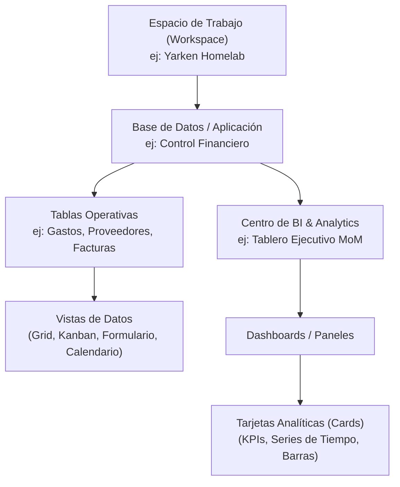

# 📖 FluxTable - Manual de Usuario Final

> **Plataforma de Datos & Business Intelligence | Sistema Yarken**  
> *Versión 2.0 (Edición Cobalto) - Fecha: 2026-11-17*  
> *Acceso Web: [https://tables.yarken.cl](https://tables.yarken.cl)*

---

## 1. Introducción a FluxTable

**FluxTable** es el centro neurálgico de gestión de datos, modelado relacional y análisis de inteligencia de negocios (BI) del Sistema Yarken. Diseñado con una interfaz moderna y eficiente basada en el **Brandbook Yarken Cobalto**, combina la flexibilidad visual de una hoja de cálculo relacional (estilo Airtable/Baserow) con la potencia analítica de tableros ejecutivos en tiempo real (estilo Metabase).

---

## 2. Jerarquía y Conceptos Clave

FluxTable organiza la información en una estructura de 4 niveles jerárquicos:

1. **Espacio de Trabajo (Workspace)**: Contenedor global que agrupa bases de datos, miembros del equipo y políticas de acceso.
2. **Base de Datos / Aplicación**: Conjunto temático de tablas relacionales y paneles analíticos.
3. **Tablas**: Colecciones de registros estructurados organizados por columnas tipadas.
4. **Vistas**: Distintas perspectivas de los datos de una tabla (Grid, Kanban, Formulario, Calendario) con filtros y ordenamientos guardados.
5. **Paneles BI (Dashboards)**: Cuadros de mando con gráficos, KPIs, comparativas periódicas y umbrales de alerta.

---

## 3. Navegación e Interfaz

La interfaz sigue los estándares del **Brandbook Cobalto**:
- **Barra de Navegación Superior**:
  - Logotipo canónico **Lechuza-Y** con baldosa azul Cobalto (`#1D5BD8`) y el identificador `FluxTable · SISTEMA YARKEN`.
  - Selector de Workspaces y botón de acceso directo a Ajustes de Cuenta y Tokens.
- **Barra Lateral Izquierda**:
  - Lista de tablas de la base activa.
  - Sección **BI & Analytics**: acceso a los Dashboards y carpetas de reportes.
- **Lienzo Central**: Fondo tenue `bg` (`#F7F8FA`) que eleva las tarjetas y tablas en blanco puro (`surface: #FFFFFF`).

---

## 4. Gestión de Tablas y Columnas

### 4.1. Creación de Campos (Columnas)
Al pulsar sobre el botón **+** en la cabecera de la tabla, puede seleccionar entre los siguientes tipos de datos:

| Tipo de Campo | Descripción | Ejemplo de Uso |
| :--- | :--- | :--- |
| **Texto Corto** | Cadena de texto de una sola línea | Nombre de proveedor, SKU |
| **Texto Largo** | Texto multilínea con formato enriquecido | Notas de auditoría, descripción |
| **Número** | Valores enteros o decimales con formato | Cantidad, precio unitario, porcentaje |
| **Selección Única** | Lista desplegable con etiquetas de color | Estado: *Pendiente*, *Aprobado*, *Rechazado* |
| **Selección Múltiple** | Asignación de varias etiquetas simultáneas | Categorías: *Hardware*, *Docker*, *Redes* |
| **Fecha / Hora** | Selector de calendario con formato regional | Fecha de vencimiento, emisión |
| **Casilla (Boolean)** | Selector binario Si / No | ¿Facturado?, ¿Revisado? |
| **Enlace a Tabla** | Relación 1:N o N:M con otra tabla | Vincular *Gasto* con un *Proveedor* |
| **Fórmula** | Expresiones matemáticas o lógicas | `IF(field('Monto') > 100000, 'Alto', 'Normal')` |
| **Adjuntos** | Carga de archivos, imágenes y PDFs | Comprobantes de transferencia, facturas |

### 4.2. Edición Rápida de Registros
- **Doble clic en celda**: Edita directamente el contenido in-line.
- **Pegado masivo**: Puede copiar rangos desde Excel o Google Sheets y pegarlos con `Ctrl+V` / `Cmd+V`.
- **Panel de Fila (Expand Row)**: Al pulsar la barra espaciadora sobre una fila seleccionada, se abre un modal lateral con todos los campos del registro detallados.

---

## 5. Vistas Disponibles

Puede crear múltiples vistas para una misma tabla sin alterar los datos subyacentes:

### 5.1. Vista Grid (Hoja de Cálculo)
- Perspectiva clásica tabular de alto rendimiento.
- Permite arrastrar columnas para reorganizarlas, cambiar su ancho y congelar columnas principales a la izquierda.
- Opciones de densidad de fila: *Compacta*, *Estándar* y *Cómoda*.

### 5.2. Vista Kanban
- Organiza los registros en columnas verticales agrupadas por un campo de **Selección Única**.
- Arrastre tarjetas entre columnas para actualizar su estado de forma instantánea.

### 5.3. Vista Formulario
- Genera un formulario de ingreso de datos ideal para capturar respuestas o nuevos registros.
- Cada formulario cuenta con un enlace web directo protegido que puede compartirse para llenado rápido.

### 5.4. Vista Calendario
- Representa los registros en una cuadrícula mensual o semanal según el campo de fecha seleccionado.

---

## 6. Módulo de BI & Analytics

El motor de BI de FluxTable le permite crear visualizaciones directas sobre tablas locales o fuentes conectadas del homelab (Odoo ERP, Voz Service, Pimcore).

### 6.1. Creación de una Tarjeta Analítica (Card)
1. Ingrese a la sección **BI & Analytics** en la barra lateral.
2. Pulse el botón **+ Nueva Tarjeta**.
3. Seleccione la **Fuente de Datos** (`Local FluxTable`, `Odoo ERP`, `Voz Service`).
4. Configure la consulta:
   - **Métrica**: Elija la función de agregación (`SUM`, `AVG`, `COUNT`, `MIN`, `MAX`, `PERCENTILE_90`).
   - **Campo a Agregar**: Seleccione el valor numérico (ej: `total_amount`).
   - **Agrupar por**: Dimensión categórica o temporal (ej: `created_at` por Mes, Día o Año; o `category_id`).
   - **Comparación Temporal**: Active la casilla *Comparar Período* para visualizar la variación porcentual frente al mes anterior (**MoM**) o año anterior (**YoY**).
5. Seleccione la **Visualización**:
   - **KPI Grande**: Muestra el valor acumulado con tipografía `JetBrains Mono` y una flecha verde o roja indicando la variación.
   - **Serie de Tiempo**: Gráfico lineal o de área para tendencias continuas.
   - **Barras**: Comparación entre categorías o canales de venta.
   - **Tabla Agregada**: Resumen numérico con totales generales.

### 6.2. Dashboards y Organización
- **Carpetas y Etiquetas**: Organice sus tarjetas en carpetas temáticas (*Finanzas*, *Infraestructura*, *E-Commerce*) y asigne etiquetas de color para búsqueda instantánea.
- **Diseño Arrastrable (Grid Layout)**: Ajuste el tamaño de cada gráfico o arrástrelo a la posición deseada en el tablero.
- **Modo Pantalla Completa**: Pulse el botón de pantalla completa para proyectar el dashboard en monitores de monitoreo o reuniones ejecutivas.

### 6.3. Umbrales y Alertas Automáticas
Puede definir alertas en cualquier tarjeta analítica:
- **Condición**: *Valor mayor que*, *Valor menor que*, o *Variación porcentual superior a*.
- **Acción**: Despacho automático de evento a **n8n** vía Webhook para notificación inmediata por Telegram o correo electrónico a Sebastián.

---

## 7. Exportación e Integraciones

- **Exportar Tabla**: Desde el menú de opciones de la vista, seleccione **Exportar a CSV** o **Descargar JSON**. Los filtros y ordenamientos activos se respetan en el archivo descargado.
- **Tokens de Acceso**: En el menú *My Settings > Database Tokens*, puede generar credenciales permanentes para conectar n8n, scripts de Python o agentes de IA.
