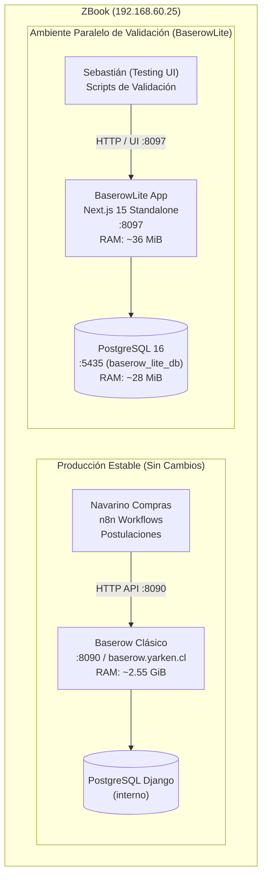

# 🔄 Plan de Convivencia en Paralelo y Validación Continua

---

## 🎯 1. Filosofía y Principio de Cero Impacto

El objetivo principal de esta etapa es **garantizar la estabilidad, robustez y usabilidad de BaserowLite viviendo en paralelo** junto al servicio de Baserow clásico, **sin ejecutar migraciones forzosas, cortes de servicio ni modificaciones en los flujos de producción activos**.

### Principios Rectores:
1. **Aislamiento Total:** Baserow oficial y BaserowLite coexisten como servicios completamente independientes, con sus propios puertos, bases de datos PostgreSQL, volúmenes y redes Docker.
2. **Cero Riesgo Operacional:** Los scripts críticos de producción (`costos/grist_compras.py`, workflows de n8n, `avance_portales.py`) continúan comunicándose exclusivamente con Baserow oficial (`:8090`).
3. **Validación Experimental en Vivo:** Toda nueva tabla, vista o caso de uso exploratorio se crea y prueba en BaserowLite (`:8097`) para evaluar ergonomía, velocidad y rendimiento en condiciones reales de uso cotidiano.

---

## 🗺️ 2. Topología de Convivencia en ZBook (`srv-zbook`)

| Parámetro | Baserow Clásico (Producción) | BaserowLite (Paralelo / Validación) |
| :--- | :--- | :--- |
| **URL / Puerto LAN** | `http://192.168.60.25:8090` | `http://192.168.60.25:8097` |
| **Dominio Externo** | `https://baserow.yarken.cl` | LAN directa / Staging |
| **Base de Datos** | Embebida en contenedor `baserow` | `baserow_lite_db` (puerto `:5435`) |
| **Consumo RAM** | ~2.55 GiB (134 procesos) | **~65 MiB** (17 procesos) |
| **Almacenamiento** | `/home/snadales/docker/baserow/data` | `/home/snadales/docker/baserow-lite/data` |
| **Respaldos** | Cron nocturno a NAS QNAP | `scripts/backup.sh` independiente a NAS QNAP |

---

## 🧪 3. Matriz de Validación Funcional y Operativa

Durante el período de convivencia en paralelo, se evaluarán rigurosamente las siguientes dimensiones funcionales:

### Dimensión A: Experiencia de Usuario y Ergonomía (UI/UX)
- [ ] **Navegación por Teclado:** Flechas de dirección, `Enter` para editar celda, `Tab` para siguiente columna, `Escape` para cancelar edición sin ratón.
- [ ] **Vistas Alternativas:** Conmutación instantánea entre Grid (tabular), Kanban (agrupación por selects y tarjetas arrastrables) y Formulario público.
- [ ] **Detalle y Documentación:** Edición de bloques de notas Markdown estilo Notion en el Drawer lateral de cada registro.
- [ ] **Formateo y Monedas:** Verificación visual de moneda chilena (`$ 190.000`) y dólares (`US$ 1,250.50`), sin decimales artificiales ni pérdida de precisión.

### Dimensión B: Motor de Fórmulas y Reactividad
- [ ] **Cálculos Matemáticos:** Operaciones aritméticas elementales, redondeo y porcentajes automáticos.
- [ ] **Evaluación Condicional:** Fórmulas con `IF(...)`, `AND(...)`, `OR(...)` y anidaciones complejas.
- [ ] **Tolerancia a Fallos:** Manejo limpio de errores sin cuelgues (`#DIV/0!`, `#VALUE!`, `#REF!`).
- [ ] **Detección de Ciclos DAG:** Prevención de dependencias circulares entre campos de fórmula.

### Dimensión C: Resiliencia y Ciclo de Vida de Datos
- [ ] **Concurrencia Optimista:** Modificación simultánea de registros validando control por campo `version`.
- [ ] **Papelera y Restauración:** Eliminación accidental y recuperación total de filas con metadatos intactos.
- [ ] **Gestión de Adjuntos:** Subida y visualización de PDFs, imágenes y comprobantes con almacenamiento SHA-256 local.

### Dimensión D: Estabilidad Operativa y Respaldo
- [ ] **Huella de Memoria Estable:** Monitoreo semanal verificando que el consumo se mantenga <150 MiB sin fugas de memoria (*memory leaks*).
- [ ] **Respaldos Automatizados:** Verificación de integridad gzip de los dumps en el NAS QNAP.
- [ ] **Healthchecks:** Vigilancia continua mediante `/api/health` y `/api/admin/diagnostics`.

---

## 🚫 4. Reglas Estrictas de no Migración

1. **PROHIBIDO apagar el contenedor clásico `baserow`:** Debe permanecer arriba y saludable en todo momento.
2. **PROHIBIDO modificar los scripts existentes de producción:** Ningún script de Navarino o n8n se reconfigura hacia el puerto `:8097` mientras dure la fase de validación.
3. **Cualquier prueba de API externa:** Debe realizarse con scripts de prueba dedicados o colecciones aisladas.
