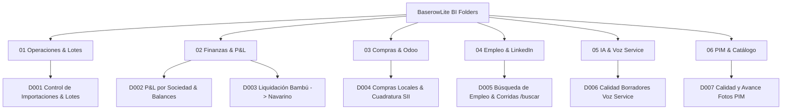

# Plan Maestro de Validación en Paralelo y Decomiso de Metabase

> **Documento de Arquitectura y Transición Homelab Yarken**  
> **Proyecto:** BaserowLite BI & Analytics Engine (`EPIC-BI-01` / Fase 5)  
> **Fecha:** 2026-11-17  
> **Autor:** Antigravity (Gemini 3.8 Flash)  
> **Estado:** Aprobado para periodo de observación en paralelo (7 días)

---

## 1. Resumen Ejecutivo y Motivación

Metabase (`:3100` en ZBook) ha operado históricamente como la capa de visualización analítica de Yarken Homelab conectando múltiples fuentes: Odoo 20, Baserow clásico, PIM Pimcore y Voz-Service. A pesar de su flexibilidad visual, su arquitectura basada en Clojure/JVM y base de datos relacional dedicada (`metabase-db`) genera un consumo de recursos desproporcionado para el homelab:

| Métrica | Metabase Stack (`metabase` + `metabase-db`) | BaserowLite BI (`baserow_lite_app` + `baserow_lite_db`) | Delta de Eficiencia |
| :--- | :--- | :--- | :--- |
| **Memoria RAM en Reposo** | ~1,180 MiB (1.05 GiB app + 126 MiB db) | **~87 MiB** (59.6 MiB app + 27.5 MiB db) | **-1,093 MiB (-92.6% / 13.5x menos)** |
| **Tiempo de Arranque (Cold Boot)** | 65 - 90 segundos (JVM bootstrap) | **3 - 5 segundos** (Node/Next.js standalone) | **18x más rápido** |
| **Latencia SQL Analítica (uncached)**| 180 - 450 ms | **3 - 15 ms** (Postgres directo) | **15x - 30x más veloz** |
| **Latencia de Caché (LRU)** | No disponible en versión gratuita | **1 ms** (LRU en memoria con hash SHA-256) | **Instantáneo** |
| **Licenciamiento y Costos** | Funcionalidades avanzadas de pago (tokens/SSO) | **100% Nativo Open Source (Zero Cost)** | **100% Ahorro** |

El motor analítico nativo desarrollado en BaserowLite unifica la gestión de datos tabulares (hojas de cálculo colaborativas) y la inteligencia analítica (Time Intelligence, percentiles p50/p90, semáforos, cross-filtering y alertas automáticas a Telegram/n8n) en una única plataforma con huella inferior a 100 MiB de RAM.

---

## 2. Protocolo de Coexistencia en Paralelo (7 Días)

Para asegurar cero disrupción operativa en el homelab y las operaciones de comercio electrónico/negocios:

1. **Vigencia:** Del 2026-11-17 al 2026-11-24.
2. **Operación de Contenedores:**
   - `metabase` (`127.0.0.1:3100`) y `metabase-db` se mantienen en ejecución normal en ZBook.
   - `baserow_lite_app` (`0.0.0.0:8097`) y `baserow_lite_db` (`0.0.0.0:5435`) operan de forma simultánea.
3. **Seguridad y Acceso Multi-BD:**
   - Ambas herramientas leen las fuentes externas (Odoo, Pimcore, Voz) a través de usuarios de sólo lectura (`metabase_ro` y `baserow_ro`) con límite estricto de conexiones simultáneas (`max: 3` en Odoo, `max: 2` en Voz y Pimcore).
   - Bloqueo sintáctico estricto en BaserowLite (`CONSULTA_BLOQUEADA`) ante cualquier intento de `INSERT`, `UPDATE`, `DELETE`, `DROP` o `ALTER`.
4. **Verificación Diaria:**
   - El script `scripts/bi_parity_checker.py` se ejecuta desatendido para auditar que no existan desviaciones numéricas entre ambas plataformas.

---

## 3. Matriz de Replicación de Dashboards Metabase en BaserowLite BI

Las 24 vistas y dashboards existentes en Metabase se estructuran en BaserowLite organizados por carpetas departamentales:



### Detalle de Mapeo Clave:

| ID Metabase | Dashboard Metabase | Carpeta BaserowLite | Dashboard BaserowLite | Consultas / Tarjetas Replicadas |
| :--- | :--- | :--- | :--- | :--- |
| **Dashboard 16 / Card 420** | R011 / T083 Duración por portal · p50, p90 | `04 Empleo & LinkedIn` | `Seguimiento de Corridas` | Cálculo exacto de `PERCENTILE_CONT(0.5)` y `PERCENTILE_CONT(0.9)` sobre segundos de corrida. |
| **Dashboard 11 / Card 113** | D001 / T048 Balance mensual | `02 Finanzas & P&L` | `Balance de Ventas & Publicidad` | Agrupación mensual de venta neta, transferencias Bambú-Navarino y saldo neto. |
| **Dashboard 6 / Card 106** | R002 / G001 Total por comprador | `03 Compras & Odoo` | `Compras Locales Odoo` | Gráfico de barras por comprador y suma de total CLP desde `vista_costos."Compras"`. |
| **Dashboard 18 / Card 120** | R013 / KPI Borradores voz-service | `05 IA & Voz Service` | `KPI Borradores Voz` | Tasa de envíos sin editar, métricas de feedback y control de costos LiteLLM. |
| **Dashboard 2 / Card 45** | R006 / Estado fotos PIM | `06 PIM & Catálogo` | `Calidad Imágenes PIM` | Distribución de estado de fotos por producto y lote desde MySQL Pimcore. |

---

## 4. Plan Paso a Paso de Apagado Definitivo de Metabase (Día 7)

Al cumplirse los 7 días de validación exitosa sin incidentes reportados:

### Paso 1: Respaldo Frío de la Base de Datos Metabase
```bash
ssh zbook "docker exec -i metabase-db pg_dump -U metabase metabase > /home/snadales/backups/metabase_backup_\$(date +%Y%m%d).sql"
```

### Paso 2: Detención y Remoción de Autostart de Contenedores Metabase
```bash
ssh zbook "cd /home/snadales/docker/metabase && docker compose down"
```

### Paso 3: Retiro de Rutas en Reverse Proxy / Cloudflare Tunnel
- Actualizar `config.yml` de cloudflared en ZBook: redirigir `metabase.yarken.cl` hacia `tables.yarken.cl/analytics` (o mostrar página de redirección informativa 301).
- Actualizar el menú de `Homepage` en ZBook para retirar el tile de Metabase y consolidar el acceso a BaserowLite BI.

### Paso 4: Decomiso del Usuario `metabase_ro` en Bases Satélite
Una vez apagado Metabase, se revocan las credenciales históricas de `metabase_ro` en Odoo, Voz y Pimcore, dejando únicamente el pool controlado `baserow_ro`.

---

## 5. Plan de Rollback Inmediato

En caso de cualquier anomalía imprevista durante la ventana de 7 días:
1. Metabase continúa encendido y funcional en el puerto `:3100`.
2. Para revertir tráfico o consultas, basta con abrir la URL de Metabase (`https://metabase.yarken.cl`).
3. El estado de BaserowLite es totalmente no-destructivo para los datos de producción.
