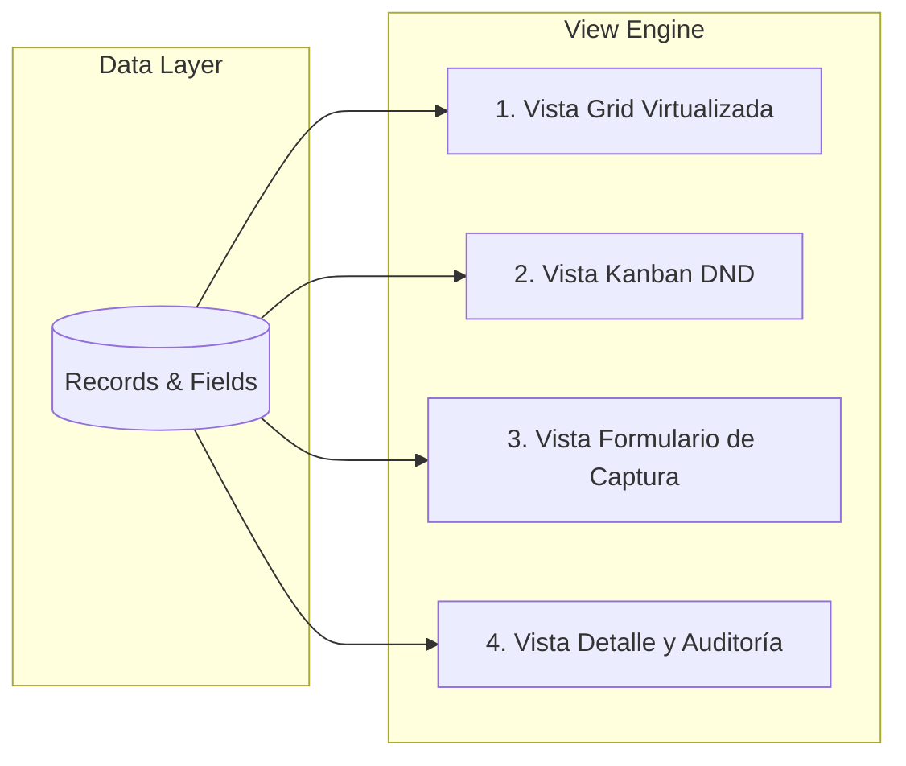

# 🎨 Motor de Vistas, Gestión de Colores y Formatos

Este documento detalla la experiencia visual, la paleta cromática, los formateadores de datos y la arquitectura de componentes para las vistas de **BaserowLite**.

---

## 1. Sistema Semántico de Colores y Badges

Baserow basa su usabilidad en colores suaves con alto contraste para etiquetas, estados, filas condicionales y badges. Se define una paleta canónica de 10 colores con tokens compatibles con Tailwind CSS:

```typescript
export interface ColorToken {
  id: string;
  name: string;
  bgLight: string;      // Fondo en modo claro
  textLight: string;    // Texto en modo claro
  borderLight: string;  // Borde en modo claro
  bgDark: string;       // Fondo en modo oscuro
  textDark: string;     // Texto en modo oscuro
  borderDark: string;   // Borde en modo oscuro
  hexAccent: string;    // Indicador o punto de color
}

export const BASEROW_PALETTE: Record<string, ColorToken> = {
  blue: {
    id: "blue",
    name: "Azul",
    bgLight: "#E1EFFE",
    textLight: "#1A56DB",
    borderLight: "#A4CAFE",
    bgDark: "rgba(26, 86, 219, 0.2)",
    textDark: "#93C5FD",
    borderDark: "#1E40AF",
    hexAccent: "#3B82F6",
  },
  green: {
    id: "green",
    name: "Verde",
    bgLight: "#EDFDF5",
    textLight: "#03543F",
    borderLight: "#A7F3D0",
    bgDark: "rgba(5, 150, 105, 0.2)",
    textDark: "#6EE7B7",
    borderDark: "#065F46",
    hexAccent: "#10B981",
  },
  yellow: {
    id: "yellow",
    name: "Amarillo",
    bgLight: "#FEFCE8",
    textLight: "#854D0E",
    borderLight: "#FEF08A",
    bgDark: "rgba(202, 138, 4, 0.2)",
    textDark: "#FDE047",
    borderDark: "#854D0E",
    hexAccent: "#EAB308",
  },
  orange: {
    id: "orange",
    name: "Naranja",
    bgLight: "#FFF7ED",
    textLight: "#9A3412",
    borderLight: "#FFEDD5",
    bgDark: "rgba(234, 88, 12, 0.2)",
    textDark: "#FDBA74",
    borderDark: "#9A3412",
    hexAccent: "#F97316",
  },
  red: {
    id: "red",
    name: "Rojo",
    bgLight: "#FEF2F2",
    textLight: "#991B1B",
    borderLight: "#FECACA",
    bgDark: "rgba(220, 38, 38, 0.2)",
    textDark: "#FCA5A5",
    borderDark: "#991B1B",
    hexAccent: "#EF4444",
  },
  purple: {
    id: "purple",
    name: "Morado",
    bgLight: "#F3E8FF",
    textLight: "#6B21A8",
    borderLight: "#E9D5FF",
    bgDark: "rgba(147, 51, 234, 0.2)",
    textDark: "#D8B4FE",
    borderDark: "#6B21A8",
    hexAccent: "#A855F7",
  },
  pink: {
    id: "pink",
    name: "Rosa",
    bgLight: "#FDF2F8",
    textLight: "#9D174D",
    borderLight: "#FBCFE8",
    bgDark: "rgba(219, 39, 119, 0.2)",
    textDark: "#F472B6",
    borderDark: "#9D174D",
    hexAccent: "#EC4899",
  },
  cyan: {
    id: "cyan",
    name: "Cian",
    bgLight: "#ECFEFF",
    textLight: "#155E75",
    borderLight: "#A5F3FC",
    bgDark: "rgba(8, 145, 178, 0.2)",
    textDark: "#67E8F9",
    borderDark: "#155E75",
    hexAccent: "#06B6D4",
  },
  gray: {
    id: "gray",
    name: "Gris",
    bgLight: "#F3F4F6",
    textLight: "#374151",
    borderLight: "#E5E7EB",
    bgDark: "rgba(75, 85, 99, 0.2)",
    textDark: "#D1D5DB",
    borderDark: "#4B5563",
    hexAccent: "#6B7280",
  },
};
```

---

## 2. Formateadores Numéricos, Monetarios y de Fechas

### 2.1. Formato Monetario (`formatCurrency`)
Permite formatear tanto monedas chilenas sin decimales (`$ 190.000`) como divisas internacionales (`$ 1,250.50`):

```typescript
export function formatCurrency(
  value: number | null | undefined, 
  options: {
    currencySymbol?: string;
    precision?: number;
    thousandsSeparator?: '.' | ',' | ' ';
    decimalSeparator?: ',' | '.' | '';
    colorNegative?: boolean;
  }
): { formattedText: string; isNegative: boolean } {
  if (value === null || value === undefined || isNaN(value)) {
    return { formattedText: '', isNegative: false };
  }

  const isNegative = value < 0;
  const absValue = Math.abs(value);
  const precision = options.precision ?? 0;
  const fixed = absValue.toFixed(precision);

  const [intPart, decPart] = fixed.split('.');
  const thousands = options.thousandsSeparator ?? '.';
  const decimal = options.decimalSeparator ?? ',';

  // Inserción de separadores de miles
  const formattedInt = intPart.replace(/\B(?=(\d{3})+(?!\d))/g, thousands);
  const formattedNumber = precision > 0 && decPart 
    ? `${formattedInt}${decimal}${decPart}` 
    : formattedInt;

  const symbol = options.currencySymbol ?? '$';
  const formattedText = `${isNegative ? '-' : ''}${symbol} ${formattedNumber}`;

  return { formattedText, isNegative };
}
```

### 2.2. Formato de Fechas (`formatDate`)
Maneja zonas horarias locales y formatos sin librerías pesadas:

```typescript
export function formatDate(
  isoDate: string | null | undefined,
  format: 'DD/MM/YYYY' | 'YYYY-MM-DD' | 'MM/DD/YYYY' = 'DD/MM/YYYY',
  includeTime: boolean = false,
  timeFormat: '24h' | '12h' = '24h'
): string {
  if (!isoDate) return '';
  const d = new Date(isoDate);
  if (isNaN(d.getTime())) return '';

  const day = String(d.getDate()).padStart(2, '0');
  const month = String(d.getMonth() + 1).padStart(2, '0');
  const year = String(d.getFullYear());

  let datePart = '';
  switch (format) {
    case 'YYYY-MM-DD': datePart = `${year}-${month}-${day}`; break;
    case 'MM/DD/YYYY': datePart = `${month}/${day}/${year}`; break;
    case 'DD/MM/YYYY':
    default: datePart = `${day}/${month}/${year}`; break;
  }

  if (!includeTime) return datePart;

  let hours = d.getHours();
  const minutes = String(d.getMinutes()).padStart(2, '0');
  if (timeFormat === '12h') {
    const ampm = hours >= 12 ? 'PM' : 'AM';
    hours = hours % 12 || 12;
    return `${datePart} ${hours}:${minutes} ${ampm}`;
  }
  return `${datePart} ${String(hours).padStart(2, '0')}:${minutes}`;
}
```

---

## 3. Arquitectura de las 4 Vistas Canónicas



### 3.1. Vista Grid (DataGrid Virtualizado)
- **Virtualización:** Implementada con `@tanstack/react-virtual` para renderizar únicamente las filas y columnas visibles en la pantalla, logrando 60 FPS con miles de filas.
- **Navegación por Teclado:**
  - `Flechas`: Desplazan la celda activa.
  - `Enter`: Entra en modo edición de celda; en una celda en edición, confirma el cambio y salta a la fila inferior.
  - `Tab` / `Shift+Tab`: Salta a la siguiente/anterior celda horizontalmente.
  - `Escape`: Cancela la edición y restaura el valor original sin mutar el servidor.
- **Renderizado por Tipo de Celda:**
  - `text`: Input directo sin borde, autoselecciona texto al enfocar.
  - `number` / `currency`: Alineación a la derecha, muestra texto formateado al perder el foco y valor numérico plano al editar.
  - `select`: Badge coloreado con la paleta de Baserow. Al hacer click abre un Popover con lista de opciones y botón de creación de nueva opción con color.
  - `multiselect`: Contenedor flexible de badges con botón `+` para añadir o remover tags.
  - `date`: Selector con calendario popover.
  - `boolean`: Checkbox centrado con toggle inmediato con tecla `Espacio` o click.
  - `attachment`: Thumbnails compactos con contador `+N` y modal de preview a pantalla completa.
  - `relation`: Chips con el valor del campo primario del registro vinculado.

### 3.2. Vista Kanban
- **Agrupamiento Automático:** La vista requiere seleccionar un campo `select` (ej: "Estado", "Etapa", "Prioridad"). Cada columna representa una opción de la lista con su color asignado.
- **Columna de Nulos:** Columna inicial ("Sin Asignar") para registros con el campo vacío.
- **Interacción Drag-and-Drop:**
  - Desarrollada con `@hello-pangea/dnd` (fork accesible y compatible con React 19 / Next 15).
  - Al soltar una tarjeta en otra columna, se realiza una mutación optimista en el cliente y un `PATCH /records/[id]` en segundo plano enviando `{ version, data: { [groupByFieldId]: newOptionId } }`.
  - Si el servidor devuelve error o conflicto de versión (409), la tarjeta regresa suavemente a su columna previa con una notificación toast de recuperación.

### 3.3. Vista Formulario
- **Generación Schema-Driven:** A partir de los `fields` de la tabla, genera dinámicamente un formulario con inputs Shadcn UI accesibles.
- **Validaciones:**
  - Valida tipos de datos y obligatoriedad (`required: true`).
  - Validación de email, URLs, montos mínimos o máximos.
- **Acceso Público con Token:**
  - Si `view.isPublic === true`, se genera un enlace compartible `/share/form/[publicToken]` sin requerir login de workspace.
  - Modo kiosco: al enviar una respuesta, muestra mensaje de agradecimiento y botón para enviar otra respuesta.

### 3.4. Vista Detalle de Registro (Drawer / Modal)
- **Despliegue Vertical:** Panel lateral deslizable (Drawer) al hacer doble click en una fila o presionar `Barra Espaciadora` sobre una fila en Grid/Kanban.
- **Pestaña de Datos:** Edición detallada de campos largos (descripciones de texto enriquecido, listas de adjuntos).
- **Pestaña de Auditoría (Activity Feed):** Línea de tiempo cronológica que muestra:
  - Quién modificó el registro (`changedBy`).
  - Fecha y hora exacta.
  - Diferencia de valores (`oldValue` ➔ `newValue`).
  - Botón para revertir un campo a su valor anterior.
